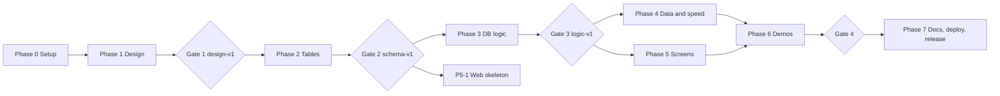

# START HERE: your guide as team leader

You are the **project leader**. The AIs are your **team members**. They write; you **assign, check, and save**. You do not need to understand every line, but you must run the checks and keep the files organized. This guide tells you exactly how.

## 1. How the system works (read once)

```
PROJECT_CONTEXT.md   = what we are building (the rulebook)   -> paste into EVERY AI session
TASKS.md             = one "task card" per job               -> paste ONE card per session
PROGRESS.md          = your checklist and handoff log        -> you update it after each task
GitHub repo          = where all finished files live         -> you commit after each task
```

**Your loop for every task (the 7 steps):**
1. Open `PROGRESS.md`, pick the next task whose "Needs" are done.
2. Open a **new chat** with an AI. Paste the **Standard Prompt** (section 4), then `PROJECT_CONTEXT.md`, then the task card, then any input files the card lists.
3. The AI replies with complete files. Save each file at the exact path it names (VS Code: create file, paste).
4. Run the **"You check"** step from the card. Expected result is written there.
5. If the check fails, paste the error back to the **same AI** and say "fix it, return the full corrected file".
6. When the check passes: **commit** (section 3) and tick the box in `PROGRESS.md`. Paste the AI's HANDOFF NOTE into the log.
7. Repeat. Several tasks marked "parallel" can be done at the same time in different chats.

## 2. The team (AI roles)

| Role | Job | Tip |
|---|---|---|
| ARCHITECT | ER model, table design, normalization (documents) | Use your strongest AI |
| DB-BUILDER | `CREATE TABLE` files | Any good AI |
| DB-LOGIC | Triggers, procedures, views, query showcase | Strong AI preferred |
| SECURITY | Roles, grants, forbidden-action demos | Strong AI preferred |
| DATA-PERF | Fake data, benchmarks, indexes | Any good AI |
| WEB | Python/FastAPI app and screens | A coding-focused AI or IDE assistant is ideal |
| QA-DEMO | Concurrency, recovery, security demos, end-to-end script | Any good AI |
| REVIEWER | Checks another AI's work against the context | **Use a different AI than the one that wrote it** |
| DOCS | Theory notes, report, viva questions, README | Any good AI |

You may use the same AI product for several roles. Each role is just a **new chat with a different task card**.
If one of your tools can read your project folder directly (an IDE or coding assistant), use it from Phase 2 onward and point it at the files instead of pasting.

## 3. First-time setup (Phase 0) and Git in plain words

**Install these (free):** Git (on Windows choose "Git for Windows", which also gives you **Git Bash**), Docker Desktop, VS Code, Python 3.11+.
**Use Git Bash as your terminal** (in VS Code: Terminal > New Terminal > pick "Git Bash"). All commands below work there.

**Words you will meet**
- **Repository (repo):** the project folder tracked by Git.
- **Commit:** a saved snapshot with a message. **Push:** upload commits to GitHub.
- **Container (Docker):** a mini computer that runs MySQL for you, so nothing messy is installed.
- **Schema:** the set of tables. **Trigger/procedure/view:** database code and saved queries.

**One-time commands (after unzipping this kit into a folder called `clinic-dbms`):**
```bash
cd clinic-dbms
git init
git add .
git commit -m "P0: starter kit"
# create an empty repo named clinic-dbms on github.com, then:
git branch -M main
git remote add origin https://github.com/YOUR-USERNAME/clinic-dbms.git
git push -u origin main
```
**Start the database:**
```bash
cp .env.example .env        # then open .env and set a password
docker compose up -d
docker compose ps           # STATUS should say "healthy" after ~30 seconds
```
**Open a MySQL prompt (to look around):**
```bash
docker compose exec mysql sh -c 'mysql -uroot -p"$MYSQL_ROOT_PASSWORD" clinic_db'
# type  SHOW TABLES;  to list tables, and  exit  to leave
```
**Wipe and rebuild the database from your files (safe, local only):**
```bash
docker compose exec mysql sh -c 'mysql -uroot -p"$MYSQL_ROOT_PASSWORD" < /db/reset.sql'
docker compose exec mysql sh -c 'mysql -uroot -p"$MYSQL_ROOT_PASSWORD" < /db/run_all.sql'
```

**Every-day Git (after each finished task):**
```bash
git status                       # see what changed
git add .
git commit -m "P2-1: core schema (settings, staff, audit)"   # message = TaskID: summary
git push
```
**Milestone tag (at each Gate):** `git tag design-v1` then `git push --tags`.
**Undo a bad AI file you have not committed:** `git restore path/to/file`.
**Undo a committed mistake:** ask any AI "how do I `git revert` commit X", or restore from the last tag.

**Folder ownership rule (prevents conflicts when AIs work in parallel):** each task writes **only** the files named in its card. If an AI wants to edit a file owned by another task, it must write a CHANGE REQUEST.

## 4. The Standard Prompt (paste first, every session)

```
ROLE: <paste the role name from the task card, e.g. DB-BUILDER>

I am a beginner project leader coordinating several AIs on one project.
Read the PROJECT CONTEXT below completely. Then do ONLY the TASK CARD that follows.

Rules:
1. If something essential is unclear, ask me at most 3 questions BEFORE starting. Otherwise start.
2. Output COMPLETE files with the exact paths from the card. Never use "..." or "rest remains same".
3. Do not explain basics unless I ask. Keep chat text short; put the work in the files.
4. Do not change any rule in the context. If you think a rule is wrong or missing, write a CHANGE REQUEST (format below) and continue with the current rule.
5. Stay inside your task. Do not create files that are not listed.
6. End with a HANDOFF NOTE in the exact format below.

CHANGE REQUEST format:
CR: <short title> | Affects: <rule/file> | Problem: <1-2 lines> | Proposal: <1-2 lines>

HANDOFF NOTE format:
HANDOFF <TaskID>
- Done: <what was completed>
- Files: <paths created/changed>
- How to check: <exact commands and expected result>
- Assumptions made: <list>
- Open issues / CRs: <list or "none">

[PROJECT CONTEXT]
<paste docs/PROJECT_CONTEXT.md>

[INPUT FILES]
<paste only the files the task card says>

[TASK CARD]
<paste ONE card from docs/TASKS.md>
```

## 5. Parallel batches (your schedule)

Run only as many chats at once as you can comfortably check. **2 or 3 at a time is fine.** Order matters; "parallel" means safe to do at the same time.

| Batch | Tasks | Run together? |
|---|---|---|
| 1 | P0-1 to P0-4 (you) + P1-6 (DOCS theory notes) | Yes |
| 2 | P1-1 then P1-2 (review loop) | In order |
| 3 | P1-3, P1-4, P1-5 | In order, then **Gate 1** |
| 4 | P2-1, P2-2, P2-3, P2-4 | **Yes, parallel** |
| 5 | P2-5 (you), P2-6 | Then **Gate 2** |
| 6 | P3-1 | Alone first |
| 7 | P3-2, P3-3, P3-4, P3-5, P3-6 and P5-1 | **Yes, parallel** (pick 2-3 at a time) |
| 8 | P3-7, P3-8, P4-1 | Yes, then **Gate 3** |
| 9 | P4-2, P4-3, P4-4, P5-2 to P5-7 | **Yes, parallel** (pick 2-3 at a time) |
| 10 | P6-1 to P6-4 | Yes, then **Gate 4** |
| 11 | P7-1 to P7-5 | Mostly parallel, then **Release** |
| Anytime | B1 bonus (C++ simulator) | Optional |



## 6. When a free AI hits its limit mid-task
1. Do **not** panic. Tasks are small on purpose, and finished files are already saved.
2. Save whatever the AI produced so far (even partial) under its path.
3. Open a **new chat with another AI**, paste: Standard Prompt + context + the task card + the **partial files**, and add: *"The previous AI ran out of limit. These files are partly done. Continue from where it stopped and return the COMPLETE finished files."*
4. If still stuck, split the card in two (e.g. "do tables 1-6 only") and note the split in `PROGRESS.md`.
5. Commit more often than you think you need to.

## 7. Change requests (how decisions change safely)
When any AI writes a CR:
1. Read it. If you agree, ask your **ARCHITECT** AI: "Apply this CR to `PROJECT_CONTEXT.md` and list every file it affects."
2. Update `PROJECT_CONTEXT.md`, record the CR in `PROGRESS.md`, and create follow-up fix tasks for affected files.
3. If you disagree, write "rejected" in the log and tell the AI to keep the current rule.
After **Gate 1**, table-design changes cost more, so batch CRs and apply them together.

## 8. Quality gates (do not skip)
| Gate | Passed when | Tag |
|---|---|---|
| Gate 1 | Design reviewed with no open issues | `design-v1` |
| Gate 2 | All schema files run on an empty DB with zero errors | `schema-v1` |
| Gate 3 | All rule tests pass | `logic-v1` |
| Gate 4 | Demos reproduce as written; all screens work | `demo-ready` |
| Release | Traceability matrix complete; README polished | `v1.0` |

## 9. Safety rules for you
- **Never paste real patient data, real passwords, or your `.env` into any AI.** Use fake data only.
- Never commit `.env`. (`.gitignore` already blocks it.)
- If an AI says "tests pass", **run them yourself**. You are the final check.
- Prefer smaller tasks over bigger ones. Small tasks fail less and cost less limit.
