# Clinic Management System — ER and Extended ER Model

**Task:** P1-1 ARCHITECT  
**Revision:** 2 — supersedes revision 1 and resolves the architect review (item-by-item matrix in Appendix A).  
**Scope:** Version 1, single small clinic in India; OPD plus short-stay/day-care episodes (about 24 h maximum).  
**Status:** Conceptual model. Physical types, indexes, `CHECK` text and cross-file foreign-key ordering are finalized in `02_table_design.md` and `db/schema/09_foreign_keys.sql`.  
**Map:** §1 notation · §2 entity catalog · §3 Extended ER · §4 relationships · §5 ternary relationship and R6.2 scope · §6 diagrams · §7 large-enterprise split · §8 R-number traceability · §9 F1–F12 coverage · §10 constraints beyond ER · §11 open items and CRs · Appendix A review matrix.

## 1. Modeling decisions and notation

1. **Visit is the care-episode parent.** An appointment is optional (walk-ins, emergencies). A visit has zero or one `ShortStayEpisode`; the episode never creates a second visit. There is **no `visit_kind` column**: OPD/short-stay aspects are derived (§3.2).
2. **Two kinds of tables (G2) plus two derived/operational labels.** Every entity carries a **Class**:
   - **M — Master:** editable, every edit audit-logged with old/new values (`AuditLog`). Carries `created_at`/`created_by`.
   - **E — Event:** append-only (`UPDATE`/`DELETE` blocked by trigger and not granted). Corrections are new rows (`corrects_id`) or reversal rows. This includes immutable *header* rows (Appointment, Visit, Bill, Prescription) and system-generated rows (AppointmentSlot).
   - **D — Derived:** not a table; a view/query/generated column (G3). Listed in §2.8.
   - **O — Operational:** system-managed infrastructure, not business data (only `IdCounter`; see §11 note N-3).
3. **Event-standard columns (`ESC`)** on every E entity: `occurred_at` (what the user says), `recorded_at` (server UTC, not user-settable), `recorded_by` (FK Staff), `recorded_by_role` (FK Role — the "hat"), `is_backfilled`, `request_uuid` (UK, G11). `ESC+C` adds `corrects_id` (self-FK; a reversal row may also name the row it reverses). Child rows inserted by the same procedure as their parent derive their `request_uuid` deterministically from the parent's (so a retry is still one set of rows).
4. **System principals (G5).** Events not caused by a logged-in human (alert generation and escalation, anonymous family-link attempts, failed or unknown logins, slot generation, backups, benchmarks, outbox simulation) are recorded under four **seeded `Staff` rows with `principal_kind = system`** and the **`SYSTEM` role**: `SYS-SCHEDULER`, `SYS-ALERT`, `SYS-FAMILY`, `SYS-AUTH`. They have no login, hold no human role, can never approve (maker-checker requires a human approver) and are the *only* way these events are written. Therefore `@app_user_id`/`@app_role` are never NULL and no table is exempt from G5.
5. **Stored value vs derived value.** A column may be stored only if it is (a) an input the actor supplied or (b) an **immutable snapshot** of a price, threshold, judgement or text shown to the actor at event time (for example `unit_price_snapshot`, `is_price_deviation`, `displayed_allergies_snapshot`). Anything recomputable from current ledgers (stock, balance, current status, remaining medicine, discharge checklist, expected cash) is derived (G3).
6. **Units (single rule).** Every `quantity*` column on `StockMovement`, `Dispensing`, `OrderItemSupply`, `CustodyHandoff`, `Leftover*`, `PrescriptionItem` and `DoseAdministration.quantity_consumed` is expressed in the medicine's **`stock_unit`** (tablet, capsule, vial, ml, …). Clinical doses (`*_dose_value` + `*_dose_unit`, e.g. 500 mg, 2 ml) are separate composite values and are never added to stock quantities.
7. **IDs.** Surrogate `BIGINT UNSIGNED` keys everywhere. A weak entity keeps a surrogate key but **must retain `UNIQUE(owner_id, partial_key)`**. Human-readable codes use the clinic code (`CLN1-000123`, `TMP-00123`). **No `clinic_id` column anywhere** (G9).
8. **Soft references.** Only `AuditLog` and `AlertEvent` use `entity_type`/`entity_id` (they must describe any table). Every business target uses typed foreign keys.
9. **Cardinality notation.** Mermaid crow's foot: `||` exactly one, `|o`/`o|` zero or one, `|{` one or more, `o{` zero or more. The marker next to entity X says how many X exist per instance of the other entity. Solid line `--` = identifying relationship (weak entity); dotted `..` = ordinary relationship. §4 adds explicit **participation** (total/partial).
10. **Attribute classification.** *Composite* attributes are shown as grouped columns; *multivalued* attributes are separate entities; *derived* attributes are §2.8 views; *(opt)* = nullable.
11. **Approval direction (G6).** `ApprovalRequest` exists first and carries the payload; the **target row holds the FK to the request** and may be inserted only when an approved decision exists (§2.7, §10.E).

## 2. Entity catalog and attribute classification

`PK` primary key · `FK` foreign key · `UK` unique · `ESC`/`ESC+C` as defined in §1.3. Classes M/E/D/O as defined in §1.2.

### 2.1 Identity and access

| Entity | Class | Key and attributes | Classification / notes |
|---|---|---|---|
| **Patient** | M | **PK** `patient_id`; `display_code` (UK); `registration_kind` (`registered`, `emergency_unknown`); `given_name`, `middle_name`, `family_name`; `date_of_birth` (opt); `approximate_age` (opt); `gender`; `aadhaar_last4` (opt); `permanent_address_*`; `temporary_address_*` | **Composite:** name; both addresses (line, locality, city, state, postal_code). Aadhaar last 4 only; no biometrics. **Derived:** current phone, age, `is_merged_away`, `merged_into_patient_id`, outstanding balance. Blood group is clinical → `PatientBloodGroup`. Emergency patients start with `TMP-` code, gender, approximate age only. |
| **PatientPhone** *(weak)* | M | **Partial key** `phone_sequence` + **FK** `patient_id`; `phone_number`; `valid_from`; `valid_to` (opt); `is_primary` | **Multivalued** patient attribute with history. Phone is never an identifier. Current phone is derived. |
| **PatientAttendant** | M | **PK** `patient_attendant_id`; **FK** `patient_id`; `name`; `relationship`; `phone`; `is_emergency_contact` | **Multivalued**. Doubles as emergency contact and as family-side recipient of custody and links. |
| **PatientAllergy** | E | **PK** `patient_allergy_id`; **FK** `patient_id`; `ingredient_id` (opt FK); `allergen_text` (opt; `CHECK` one of the two); `reaction`; `severity`; `ESC+C` | **Multivalued** patient attribute. Linking to `Ingredient` makes the R4.4 match work for combination drugs. Current state derived from `PatientAllergyStatusEvent`. |
| **PatientAllergyStatusEvent** | E | **PK**; **FK** `patient_allergy_id`; `status` (`confirmed`, `inactive`, `reactivated`, `entered_in_error`); `reason`; `ESC` | Latest row = current status. |
| **PatientBloodGroup** | E | **PK** `patient_blood_group_id`; **FK** `patient_id`; `abo_group`; `rh_factor`; `source` (`patient_reported`, `card_seen`, `lab_confirmed`); `lab_report_id` (opt FK); `ESC+C` | Clinical record (R1.3), **not identity** and not a vital sign. Latest non-corrected row is current. |
| **PatientMergeLog** | E | **PK**; `source_patient_id` (FK, **UK** — merged away at most once); `surviving_patient_id` (FK); `reason`; `suggested_match_tier` (opt: T1–T4); `ESC` | Human-confirmed (G12): `recorded_by` is the confirming person. `CHECK source ≠ survivor`; survivor must not itself be merged away. **This row is the derivable marker** that a patient was merged away. |
| **CounterCustomer** | M | **PK**; `phone` (opt); `temporary_code` (opt, UK); `display_name` (opt); `CHECK` phone or temporary_code present | Counter buyer; **not** a `Patient` (R5.6). |
| **CounterCustomerLinkEvent** | E | **PK**; **FKs** `counter_customer_id`, `patient_id`; `reason`; `ESC` | Audited, human-confirmed link; never a silent merge. |
| **Staff** | M | **PK** `staff_id`; `display_code` (UK); `principal_kind` (`human`, `system`); `given_name`, `family_name`; `phone`; `active_from`; `active_to` (opt); `login_subject` (UK; NULL for system principals) | **Composite:** name. No credentials stored as readable attributes. Four seeded system principals (§1.4). |
| **Role** | M | **PK**; `role_code` (UK); `role_name` | Catalog: `OWNER`, `DOCTOR`, `RECEPTIONIST`, `NURSE`, `PHARMACY`, `ACCOUNTANT`, `SYSTEM`. Patient/family is not a role (tokenized link). Lab technician deferred to V2. |
| **StaffRole** | M | **PK**; **FKs** `staff_id`, `role_id`; `valid_from`; `valid_to` (opt); `granted_by` (FK Staff); `UNIQUE(staff_id, role_id, valid_from)` | Associative entity resolving Staff M:N Role (overlapping roles allowed). `SYSTEM` role ⇔ `principal_kind = system`. |
| **DoctorDetail** | M | **PK/FK** `staff_id`; `registration_number`; `specialty` (opt) | Subtype of Staff (S1, §3.1). Row allowed only if staff holds `DOCTOR`. Also the per-doctor **lock anchor** for booking (§10.F). |
| **NurseDetail** | M | **PK/FK** `staff_id`; `registration_number` (opt) | Subtype (S1). |
| **PharmacistDetail** | M | **PK/FK** `staff_id`; `registration_number` (opt) | Subtype (S1); backs the `PHARMACY` role. |
| **AccountantDetail** | M | **PK/FK** `staff_id`; `accounting_reference` (opt) | Subtype (S1). |
| **ReceptionistDetail** | M | **PK/FK** `staff_id`; `desk_label` (opt) | Subtype (S1). |

### 2.2 Scheduling, visit flow, short stay and discharge

| Entity | Class | Key and attributes | Classification / notes |
|---|---|---|---|
| **DoctorSchedule** | E | **PK** `doctor_schedule_id`; **FK** `doctor_staff_id`; `weekday`; `start_time`; `end_time`; `slot_minutes`; `valid_from`; `schedule_state` (`active`, `withdrawn`); `supersedes_doctor_schedule_id` (opt self-FK); `ESC` | Versioned, never edited (R3.7: old timing stays traceable). **Derived:** effective end = `valid_from` of the superseding row. |
| **AppointmentSlot** | E | **PK** `appointment_slot_id`; **FK** `doctor_schedule_id`; `doctor_staff_id` (composite FK with schedule); `slot_start`; `slot_end`; `UNIQUE(doctor_staff_id, slot_start)`; `ESC` (by `SYS-SCHEDULER`) | Generated bookable unit; the **lock anchor and declarative uniqueness** for R3.6. **Derived:** `is_bookable` (schedule version still effective, no live claim). |
| **ScheduleChangeRequest** | E | **PK**; **FK** `doctor_staff_id`; `target_doctor_schedule_id` (opt FK; required for modify/withdraw); `change_kind` (`modify`, `add_session`, `withdraw_session`); `proposed_weekday`, `proposed_start_time`, `proposed_end_time`, `proposed_slot_minutes`, `proposed_valid_from`; `reason`; `ESC` | The doctor requests (`recorded_by` = that doctor). Targets the schedule version being changed, so "what is being changed" is explicit. |
| **ScheduleChangeApplication** | E | **PK**; **FK** `schedule_change_request_id` (**UK**); `outcome` (`applied`, `declined`); `resulting_doctor_schedule_id` (opt FK, UK; required if applied); `reason`; `ESC` | An authorized person (not the requester) applies it. Appointments on slots of a superseded version surface in a "needs rebooking" view. |
| **Appointment** | E | **PK** `appointment_id`; **FKs** `patient_id`, `doctor_staff_id`; `booking_channel`; `ESC` | Immutable booking header. **No free start/end:** time comes from the claimed slot. **Derived:** current status, scheduled start/end. Optional for a visit. |
| **AppointmentSlotClaim** | E | **PK**; **FKs** `appointment_id`, `appointment_slot_id`; `claim_reason` (`initial`, `reschedule`); `ESC` | Associative event Appointment × Slot. Latest claim is effective; a claim is *live* unless the appointment's latest status is Cancelled or No-show. Slot's doctor must equal the appointment's doctor. |
| **AppointmentStatusHistory** *(weak)* | E | **Partial key** `status_seq` + **FK** `appointment_id`; `status` (`Booked`, `Checked-in`, `Waiting`, `In consultation`, `Completed`, `Cancelled`, `No-show`); `reason`; `ESC` | Weak on Appointment; `UNIQUE(appointment_id, status_seq)`. Latest row = current status. |
| **Visit** | E | **PK** `visit_id`; **FKs** `patient_id`, `appointment_id` (opt, **UK**); `entry_type` (`appointment`, `walk_in`, `emergency`); `ESC` (`occurred_at` = opened) | Immutable parent of clinical, pharmacy, lab, billing, discharge rows. **Derived:** current status/location, attending doctor, closed state, OPD/short-stay aspect. |
| **VisitDoctorAssignment** | E | **PK**; **FKs** `visit_id`, `doctor_staff_id`; `assignment_role` (`attending`, `covering`); `reason`; `ESC` | Gives walk-ins an attending doctor (R3.3 "With Doctor"). Initial row inserted with the visit when an appointment exists. Attending doctor = latest `attending` row. |
| **VisitStatusHistory** *(weak)* | E | **Partial key** `status_seq` + **FK** `visit_id`; `status` (Arrived, Waiting, With Doctor, Lab, Pharmacy, Billing, Discharged); `location_label` (opt, e.g. "Observation Area"); `reason`; `ESC` | Weak on Visit; `UNIQUE(visit_id, status_seq)`. Location is only a label — **no beds**. |
| **VisitClosure** | E | **PK**; **FK** `visit_id`; `closure_kind` (`discharged`, `administrative`); `reverses_visit_closure_id` (opt self-FK); `approval_request_id` (opt FK; required when reversing); `reason`; `ESC` | Closing never mutates Visit. Reopening a closed visit is a finalized-record correction (G6). |
| **ShortStayEpisode** | E | **PK** `short_stay_episode_id`; **FK** `visit_id` (**UK**); `admission_reason`; `ESC` (`occurred_at` = start) | Subtype of Visit (S2). **No extension columns.** **Derived:** allowed-until (`stay_limit_hours` + Σ extensions), duration, over-limit flag. `UNIQUE(short_stay_episode_id, visit_id)`. |
| **ShortStayExtension** | E | **PK**; **FK** `short_stay_episode_id`; `approval_request_id` (**FK, UK**); `extended_until`; `reason`; `ESC` | Extension is its own approved event (R3.4); resolves the G2 violation of revision 1. |
| **ShortStayClosure** | E | **PK**; **FK** `short_stay_episode_id`; `reason`; `ESC` | End time is derived from the closure event. |
| **VitalsObservation** *(weak)* | E | **Partial key** `observation_seq` + **FK** `visit_id`; `short_stay_episode_id` (opt; composite FK with `visit_id`); `observation_set_uuid`; `observation_type` (`bp_systolic`, `bp_diastolic`, `pulse`, `temperature`, `spo2`, `resp_rate`, `weight`, `height`, `blood_glucose`, `other`); `numeric_value`; `text_value`; `unit`; `ESC+C` | Weak on Visit; `UNIQUE(visit_id, observation_seq)`. **BP is two typed rows sharing `observation_set_uuid`.** Recording nurse = `recorded_by`. Blood group is *not* a vital. |
| **ClinicalSignoff** | E | **PK**; **FK** `visit_id`; `discharge_instructions`; `ESC+C` | Doctor's own event (G1). Replaces `clinical_signoff_by/at` on Discharge. |
| **ClinicalEmergencyOverride** | E | **PK**; **FK** `visit_id`; `override_type` (`financial_gate_bypass`); `authorized_by_staff_id` (FK, must hold `DOCTOR`); `clinical_justification`; `ESC` | R9.2 explicit attributes. Raises an immediate safety interrupt (R10.2). Never withholds medical documents. |
| **Discharge** | E | **PK**; **FK** `visit_id` (**UK**); `clinical_signoff_id` (FK, required); `financial_gate_basis` (`bill_settled`, `approved_partial_payment`, `emergency_override`); `approval_request_id` (opt; required iff `approved_partial_payment`); `clinical_emergency_override_id` (opt, UK; required iff `emergency_override`); `ESC` | One transaction closes visit, stay and bill. Checklist readiness is **derived** (clinical sign-off, R6.2 reconciliation, reports reviewed, bill finalized, balance zero or approved). |

### 2.3 Clinical notes, prescriptions and orders

| Entity | Class | Key and attributes | Classification / notes |
|---|---|---|---|
| **ClinicalNote** | E | **PK**; **FK** `visit_id`; `note_text`; `sharing_classification` (`shareable`, `not_for_sharing`); `ESC+C` | Doctor-authored; correction = amendment row. Not-for-sharing notes never reach family links. |
| **Diagnosis** | E | **PK**; **FK** `visit_id`; `diagnosis_text`; `diagnosis_code` (opt); `ESC+C` | Hidden from reception views. |
| **Prescription** | E | **PK** `prescription_id`; **FK** `visit_id`; `ESC` | **Immutable root** of all versions (fixes "versions have no root"). **Derived:** current version. |
| **PrescriptionVersion** | E | **PK** `prescription_version_id`; **FK** `prescription_id`; `version_number`; `change_reason`; `UNIQUE(prescription_id, version_number)`; `ESC` | One row per version (R4.1); old versions stay. Each version is a **complete snapshot** of every line. |
| **PrescriptionLine** *(weak)* | E | **Partial key** `line_no` + **FK** `prescription_id`; `UNIQUE(prescription_id, line_no)`; `ESC` | **Stable lineage anchor** of one prescribed medicine across versions. Dispensing and status hang off the line, so v2 never loses the link to what v1 dispensed. |
| **PrescriptionItem** | E | **PK**; **FKs** `prescription_version_id`, `prescription_line_id`, `prescription_id` (both composite FKs prove version and line belong to the same prescription); `UNIQUE(prescription_version_id, prescription_line_id)`; `item_change` (`added`, `modified`, `unchanged`, `discontinued`); `medicine_id` (opt FK); `free_text_medicine_name` (opt; `CHECK` exactly one of the two); `chosen_dose_text`; `chosen_schedule` (e.g. `1-0-1`); `food_instruction`; `duration_days`; `quantity_prescribed`; `ESC` | **Associative entity** PrescriptionVersion × PrescriptionLine. Stores what the doctor chose (R4.3), not catalog defaults. |
| **PrescriptionLineStatus** | E | **PK**; **FK** `prescription_line_id`; `status` (`prescribed`, `bought_outside`, `not_needed`, `cancelled`); `reason`; `ESC` | R4.6 "item status" is a **line** status. Initial `prescribed` row inserted with the line. "Bought outside while in stock" is a derived flag (stock as of event time). |
| **AllergyConfirmation** | E | **PK**; **FK** `prescription_item_id`; `confirmation_type` (`free_text_medicine`, `generic_name_warning`); `displayed_allergies_snapshot`; `was_overridden`; `override_reason` (opt); `ESC` | Snapshot of what the doctor saw (R4.4). Patient is derived via item → version → prescription → visit. An override raises a safety interrupt (R10.2). |
| **CatalogReviewQueue** | E | **PK**; **FK** `prescription_item_id`; `submitted_name`; `ESC` | Free-text name awaiting mapping (R4.5). |
| **CatalogReviewEvent** | E | **PK**; **FK** `catalog_review_queue_id`; `review_action` (`mapped`, `added_to_catalog`, `rejected`); `resolved_medicine_id` (opt FK); `resolution_note`; `ESC` | Latest row = outcome. |
| **ClinicalOrder** | E | **PK** `clinical_order_id`; **FK** `visit_id`; `short_stay_episode_id` (opt; composite FK with `visit_id`); `order_type` (`medication`, `procedure`, `observation`, `iv_fluid`); `ESC` | Doctor-authored header (R4.7). **Derived:** current status. |
| **ClinicalOrderStatus** | E | **PK**; **FK** `clinical_order_id`; `status` (`ordered`, `finalized`, `cancelled`, `completed`); `reason`; `ESC` | Order-level trail; nurses see `finalized` orders (permission table). |
| **ClinicalOrderItem** *(weak)* | E | **Partial key** `item_no` + **FK** `clinical_order_id`; `UNIQUE(clinical_order_id, item_no)`; `item_kind` (`medication`, `procedure`, `observation`); `medicine_id` (opt); `free_text_medicine_name` (opt); `price_list_id` (opt, procedures); `dose_value`, `dose_unit` (composite dose); `route`; `first_scheduled_at`; `repeat_interval_minutes` (opt); `quantity_ordered` (opt); `instructions`; `supersedes_clinical_order_item_id` (opt self-FK); `ESC` | A change is a **new item** that supersedes the old one (R4.1 principle extended to orders). Surrogate `clinical_order_item_id` is what other tables reference; `UNIQUE(clinical_order_id, item_no)` is retained. |
| **ClinicalOrderItemStatus** | E | **PK**; **FK** `clinical_order_item_id`; `status` (`active`, `stopped`, `superseded`); `reason`; `ESC` | **Item-level** stop/change by the doctor; initial `active` row inserted with the item. Current item status derived. |
| **DoseAdministration** | E | **PK**; **FK** `clinical_order_item_id`; `order_item_supply_id` (opt); **composite FK** `(order_item_supply_id, clinical_order_item_id)` → `OrderItemSupply`; `status` (`given`, `missed`, `refused`, `delayed`, `stopped`); `ordered_dose_value`, `ordered_dose_unit`, `ordered_route`; `actual_dose_value`, `actual_dose_unit`, `actual_route`; `quantity_consumed` (stock units; `> 0` only if `given` and a supply is set); `deviation_reason` (opt); `deviation_authorized_by` (opt FK); `ESC+C` | Nurse = `recorded_by`. Stores **ordered and actual** values (R6.1). The composite FK **guarantees the supply belongs to the dose's own order item**; `dispensing_id` is reached through the supply row. **Derived:** `is_deviation`. Dose above order → safety interrupt. |

### 2.4 Pharmacy, inventory, custody and counter sales

| Entity | Class | Key and attributes | Classification / notes |
|---|---|---|---|
| **Ingredient** | M | **PK**; `ingredient_name` (UK) | Active ingredient master for allergy matching. |
| **Medicine** | M | **PK** `medicine_id`; `brand_name`; `generic_display_name`; `strength_value`, `strength_unit` (composite); `dosage_form`; **`stock_unit`**; `schedule_class` (`none`, `H`, `H1`, `X`); `default_dose_text`; `default_schedule`; `default_food_instruction`; `default_duration_days`; `returnable`; `active` | Catalog master. Defaults are suggestions only. **Derived:** current stock and the R4.2 label (green "In stock: n", blue out of stock, red not in catalog). |
| **MedicineIngredient** | M | **PK** `(medicine_id, ingredient_id)`; `strength_text` (opt) | M:N link; fixes single-valued `generic_name` for combination drugs (R4.4). |
| **Supplier** | M | **PK**; `name`; `phone`; `contact_name`; `notes` | Minimal, optional on receipts. No supplier accounting. |
| **StockBatch** | M | **PK**; **FKs** `medicine_id`, `supplier_id` (opt); `batch_code`; `expiry_date`; `cost_price`; `mrp`; `UNIQUE(medicine_id, batch_code)` | `DECIMAL(12,2)`. Cost price visible only to owner and pharmacy. **Derived:** quantity on hand, expired, near-expiry, FEFO rank. |
| **StockMovement** | E | **PK**; **FK** `stock_batch_id`; `movement_type` (`received`, `dispensed`, `returned_by_patient`, `returned_to_supplier`, `expired_writeoff`, `adjustment`, `reversal`); `quantity_delta` (signed, stock units); **`unit_price_snapshot`** (opt; required for `dispensed` and `returned_by_patient`); `dispensing_id` (opt; iff `dispensed`); `returns_stock_movement_id` (opt; iff `returned_by_patient`); `reverses_stock_movement_id` (opt; iff `reversal`); `reason`; `approval_request_id` (opt; required for `adjustment` and `expired_writeoff`); `ESC` | Append-only ledger; stock = `SUM` per batch (R5.2). **Price per stock-out movement** resolves FEFO drawing from batches with different MRPs. `received` carries receiver (`recorded_by`) and timestamp (R5.1). |
| **OutsidePrescription** | E | **PK**; **FK** `counter_customer_id`; `prescriber_name`; `prescriber_registration_no`; `photo_path` (opt); `prescription_date`; `ESC` | Now has a **buyer** (fixes the missing buyer path). |
| **CounterSale** | E | **PK**; **FK** `counter_customer_id`; `sale_number` (UK); `ESC` | **Header for every pharmacy sale to a counter customer**, whether OTC or outside-prescription. **Derived:** total, paid, balance. |
| **CounterSalePayment** | E | **PK**; **FK** `counter_sale_id`; `amount`; `method`; `receipt_number` (UK); `approval_request_id` (opt; required for a reversal row); `ESC+C` | Pharmacy-recorded, counter sales only (R5.7). |
| **CounterSaleReturn** | E | **PK**; **FK** `counter_sale_id`; `returned_stock_movement_id` (FK, UK); `reason`; `ESC` | Stock side of a counter-sale return; the movement is `returned_by_patient` and points at the original `dispensed` movement. |
| **CounterSaleRefund** | E | **PK**; **FK** `counter_sale_id`; `counter_sale_return_id` (opt FK); `amount`; `method`; `receipt_number` (UK); `approval_request_id` (FK, required); `ESC+C` | Money side; owner-approved. Disbursement role: CR-3. |
| **Dispensing** | E | **PK** `dispensing_id`; `source_type` (`clinic_prescription`, `outside_prescription`, `otc`); **FK** `medicine_id`; `prescription_item_id` (opt); `outside_prescription_id` (opt); `counter_sale_id` (opt); `ESC+C` | Header only — **no `quantity`/`unit_price`** (derived from its stock-out movements). `CHECK` per source (§3.3). Schedule H/H1/X cannot be `otc`. Pharmacist = `recorded_by`. **Derived:** quantity dispensed, amount. |
| **OrderItemSupply** | E | **PK** `order_item_supply_id`; **FKs** `clinical_order_item_id`, `dispensing_id`; `quantity_allocated`; `reverses_order_item_supply_id` (opt); `UNIQUE(order_item_supply_id, clinical_order_item_id)`; `ESC` | **Associative event** OrderItem × Dispensing. Marks a dispensing as *order-linked* (R6.2 scope, §5). An order-linked dispensing must be fully allocated. |
| **CustodyHandoff** | E | **PK**; **FK** `dispensing_id`; `giver_staff_id` (`CHECK = recorded_by`); `recipient_staff_id` (opt); `recipient_attendant_id` (opt); `CHECK` exactly one recipient; `quantity`; `handoff_purpose` (`supply_to_nurse`, `take_home`, `leftover_to_family`); `leftover_return_decision_id` (opt; iff `leftover_to_family`); `ESC` | **Ternary** Dispensing × giver × recipient (§5). Giver records (G1). Recipient type is derived from which FK is set. |
| **CustodyHandoffAcknowledgement** | E | **PK**; **FK** `custody_handoff_id` (**UK**); `acknowledged_quantity`; `ack_method` (`self_logged_staff`, `witnessed_attendant`); `witness_note`; `ESC` | Recipient side (G1). Staff recipient: `recorded_by` = that staff member. Attendant recipient: witnessed by a staff member **other than the giver** (CR-4). **Derived:** discrepancy (acknowledged ≠ handed). |
| **LeftoverReturnRequest** | E | **PK**; **FK** `dispensing_id`; `quantity`; `condition_note`; `ESC` | **Nurse's** ask to pharmacy (R6.3). |
| **LeftoverReturnDecision** | E | **PK**; **FK** `leftover_return_request_id` (**UK**); `decision` (`accepted`, `refused`); `decision_reason`; `stock_movement_id` (opt, UK; required iff `accepted`); `ESC` | **Pharmacist's** decision (a second actor, so a second row). Accepted → `returned_by_patient` movement + negative `BillLine`; refused → `CustodyHandoff` with purpose `leftover_to_family`. |
| **CashHandoverDeclaration** | E | **PK**; `period_start`; `period_end`; `declared_amount`; `note`; `ESC` | **Pharmacist** declares (R5.7). |
| **CashHandoverCount** | E | **PK**; **FK** `cash_handover_declaration_id` (**UK**); `counted_amount`; `note`; `ESC` | **Accountant** counts (`recorded_by` ≠ declarer). **Derived:** expected amount (cash counter-sale payments minus cash counter-sale refunds by that pharmacist in the period) and both differences; non-zero difference flags the owner. |

### 2.5 Outside laboratory

| Entity | Class | Key and attributes | Classification / notes |
|---|---|---|---|
| **OutsideLab** | M | **PK**; `name`; `phone`; `contact_name`; `notes` | Minimal master. No in-house lab and no lab technician in V1. |
| **LabOrder** | E | **PK** `lab_order_id`; **FKs** `visit_id`, `outside_lab_id`, `clinical_order_id` (opt); `test_name`; `ESC` | Doctor-authored. No status, price or billed flag stored here. Billed/not-billed is a reconciliation query (R7.5). |
| **LabOrderStatus** | E | **PK**; **FK** `lab_order_id`; `status` (`ordered`, `sample_collected`, `sent_to_lab`, `cancelled`); `reason`; `ESC` | Holds **only order-lifecycle steps**. "Report received" and "Reviewed by doctor" are facts of `LabReport`/`LabReportReview` and are **not duplicated here**; the five-step R7.2 trail is a derived view over all three. |
| **LabOrderPrice** | E | **PK**; **FK** `lab_order_id`; `entered_price`; `price_basis` (`price_list`, `previous_price`, `manual`); `expected_price` (opt); `is_price_deviation`; `deviation_reason` (opt); `ESC+C` | R8.1 per-test price with **deviation flag**. A separate event because LabOrder is immutable and the price may be entered or corrected later. `is_price_deviation` is a snapshot against the `lab_price_deviation_pct` setting at entry time. |
| **LabReport** | E | **PK** `lab_report_id`; **FK** `lab_order_id`; `version_number`; `supersedes_lab_report_id` (opt self-FK); `file_path`; `content_hash`; `source` (`from_lab`, `brought_by_patient`); `UNIQUE(lab_order_id, version_number)`; `ESC` | Immutable as received; correction = new version (R7.3). No structured values (R7.6 design hook only). **Derived:** is_current, is_retracted, is_critical, is_reviewed. |
| **LabReportIdentifierCheck** | E | **PK**; **FK** `lab_report_id`; `identifier_kind` (`patient_name`, `date_of_birth`, `patient_code`, `phone_last4`, `age_gender`); `value_seen`; `matches_order`; `ESC` | Replaces the repeating `identifier_check_1/2` attributes. Attach procedure requires **≥ 2 distinct kinds with `matches_order = 1`** (logged, R7.3). |
| **LabReportCriticalMark** | E | **PK**; **FK** `lab_report_id`; `mark` (`critical`, `not_critical`); `mark_source` (`lab_stamp`, `nurse_observation`, `doctor_assessment`); `reason`; `ESC` | Makes "critical report unreviewed past limit" (R10.2) evaluable. Latest mark wins. |
| **LabReportReview** | E | **PK**; **FK** `lab_report_id`; `review_note`; `ESC` | "Doctor reviewed" is its own event (R7.4); reviewer = `recorded_by` (DOCTOR). |
| **LabReportRetraction** | E | **PK**; **FK** `lab_report_id`; `retraction_kind` (`wrong_patient`, `wrong_order`, `corrupt_file`, `superseded_by_lab`); `correct_lab_order_id` (opt FK); `note`; `ESC` | Wrong-patient retraction (R10.2). A retracted report is excluded from "received" and "reviewed" derivations; the file is re-attached to the right order as a new `LabReport` there. |

### 2.6 Billing and payments

| Entity | Class | Key and attributes | Classification / notes |
|---|---|---|---|
| **PriceList** | M | **PK**; `item_code`; `description`; `category` (`consultation`, `stay`, `procedure`, `injection`, `drip`, `other`); `price`; `effective_from`; `effective_to` (opt); `active`; `UNIQUE(item_code, effective_from)` | Owner-only master (R8.1); edits audited; effective-dated. |
| **Bill** | E | **PK** `bill_id`; **FK** `visit_id` (**UK**); `bill_number` (UK); `ESC` | Immutable header. **Derived:** state (Draft → Finalized → Settled), total, paid, refunded, **balance**. One bill per visit in V1 (§11 note N-4). |
| **BillLine** *(weak)* | E | **Partial key** `line_no` + **FK** `bill_id`; `UNIQUE(bill_id, line_no)`; `line_type` (`price_list_item`, `medicine`, `lab_test`, `stay`, `discount`, `free_service`, `return_credit`, `post_finalization_credit`, `post_finalization_debit`, `manual`); `price_list_id` (opt); `source_stock_movement_id` (opt); `lab_order_id` (opt); `short_stay_episode_id` (opt); `description_snapshot`; `quantity`; `unit_price_snapshot`; **`price_source`** (`price_list`, `batch_mrp`, `lab_entered`, `manual`); **`is_manual_price`**; **`expected_unit_price`** (opt); **`is_price_deviation`**; `reason`; `reverses_bill_line_id` (opt); `approval_request_id` (opt; required for `discount`, `free_service`, `post_finalization_*`); `ESC` | **Generated from events** (R8.2): one medicine line per stock-out movement. `line_amount = quantity × unit_price_snapshot` is **derived** (generated column). `CHECK` `is_manual_price` ⇒ `reason`. Manual-price report = `WHERE is_manual_price`. Discounts and free services are separate negative lines. |
| **BillFinalization** | E | **PK**; **FK** `bill_id` (**UK**); `reason`; `ESC` | Who/when finalized is read from here, never stored on Bill. |
| **Payment** | E | **PK**; **FK** `bill_id`; `payment_kind` (`payment`, `reversal`); `amount`; `method` (`cash`, `upi`, `card`); `receipt_number` (UK); `approval_request_id` (opt; required for `reversal`); `ESC+C` | Accountant-recorded (R8.5). Completed payments are corrected only by an **approved reversal row**. Every payment emits a receipt message. |
| **Refund** | E | **PK**; **FK** `bill_id`; `payment_id` (opt); `credit_bill_line_id` (opt FK); `amount`; `method`; `receipt_number` (UK); `approval_request_id` (FK, required); `ESC+C` | `credit_bill_line_id` ties a leftover-return refund to its credit line (R6.3). Balance = total − payments + refunds (derived). |
| **DuePromise** | E | **PK**; **FKs** `visit_id`, `bill_id`; `promised_by_date`; `approval_request_id` (opt; set on the discharge-time promise); `reason`; `ESC` | Persists the **promised-by date** (R9.1/R9.3). A later extension of the promise is another row; latest wins. |
| **Due** | D | *(view)* per bill: `amount_due`, `due_status` (`due`, `overdue`, `cleared`), `latest_promised_by` | Derived from bill lines, payments, refunds, promises and current time. Reminders are `MessageOutbox` rows. |

### 2.7 Approvals, authority, audit, alerts, family access and operations

| Entity | Class | Key and attributes | Classification / notes |
|---|---|---|---|
| **ApprovalRequest** | E | **PK**; `request_type` (catalog below); typed context FKs `visit_id`, `bill_id`, `stock_batch_id`, `short_stay_episode_id`, `counter_sale_id` (each opt; `CHECK` the set required by `request_type`); **payload:** `requested_amount` (opt), `requested_quantity` (opt), `proposed_change` (text); `reason`; `ESC` | The **maker**. Has **no target FK**. **Derived:** status (`pending` = no decision; `approved`; `rejected`; `consumed` = target row exists). Creating one raises an immediate approval-pending alert (R10.3). |
| **ApprovalDecision** | E | **PK**; **FK** `approval_request_id` (**UK**); `decision` (`approved`, `rejected`); `decision_channel` (`in_app`, `phone_remote`); `authority_delegation_id` (opt FK); `decision_reason`; `ESC` | The **checker** = `recorded_by`; must be a human principal ≠ requester, and be the owner or a delegate whose scope/limit/validity covers `requested_amount`. One final decision per request; a re-ask is a new request. |
| **AuthorityDelegation** | E | **PK**; `delegate_staff_id` (FK); `scope` (`discount`, `partial_payment`, `approval_backup`, `alert_escalation_backup`); `limit_amount` (opt); `valid_from`; `valid_to`; `ESC` | Delegator = `recorded_by` (owner). Immutable grant. |
| **AuthorityDelegationRevocation** | E | **PK**; **FK** `authority_delegation_id`; `reason`; `ESC` | Early revocation event. |
| **AuditLog** | E | **PK**; `action`; `entity_type`; `entity_id`; `old_values`; `new_values`; `reason`; `ESC` | Insert-only for **everyone including owner** (R10.6). Master-edit triggers write it. Soft reference by design (§1.8). |
| **AlertEvent** | E | **PK**; `alert_class` (`safety_interrupt`, `approval_pending`, `daily_summary_item`); `alert_type`; `severity` (`red`, `amber`); `source_entity_type`; `source_entity_id`; `summary`; `ESC` (by `SYS-ALERT`) | Immediate interrupts only for the R10.2 safety list; money events wait for the daily summary. **Derived:** acknowledged, escalated. |
| **AlertAcknowledgement** | E | **PK**; **FK** `alert_event_id`; `note`; `ESC` | Acknowledger = `recorded_by`. |
| **AlertEscalation** | E | **PK**; **FK** `alert_event_id`; `escalated_to_staff_id` (FK); `reason`; `ESC` (by `SYS-ALERT`) | Backup person if unanswered (R10.4). |
| **LoginSessionEvent** | E | **PK**; `staff_id` (opt FK); `claimed_role_id` (opt FK); `login_identifier`; `session_id_hash`; `event_type` (`login_success`, `login_failed`, `logout`, `role_switch`, `session_timeout`); `source_context`; `ESC` | Failed/unknown logins are recorded by `SYS-AUTH`. Feeds shared-login reports (R10.5). No credentials stored. |
| **MessageOutbox** | E | **PK**; `message_type` (`family_link`, `receipt`, `due_reminder`, `appointment_reminder`); `recipient_phone`; `safe_template_key`; typed opt FKs `family_link_id`, `payment_id`, `counter_sale_payment_id`, `due_promise_id` (`CHECK` matches type); `ESC` | Simulated SMS/WhatsApp (project scope: no real sending). Text never carries patient details. **Derived:** delivery state. |
| **MessageDeliveryEvent** | E | **PK**; **FK** `message_outbox_id`; `delivery_state`; `details`; `ESC` | Latest row = state. |
| **FamilyLink** | E | **PK**; **FK** `visit_id`; `attendant_id` (opt FK); `token_hash` (UK); **`second_factor_kind`** (`date_of_birth`, `printed_code`); **`printed_code_hash`** (opt; required iff `printed_code`); `expires_at`; `consent_note`; `ESC` | Scoped to one visit/stay; patient derived via the visit. **Printed code for DOB-less emergency patients is stored here as a hash only** (the code itself exists once, on paper). `expires_at` snapshots `link_expiry_days`. **Derived:** revoked, expired, locked. |
| **FamilyLinkRevocation** | E | **PK**; **FK** `family_link_id`; `reason`; `ESC` | Instant revocation without mutating the link. |
| **LinkAccessLog** | E | **PK**; `family_link_id` (opt FK; NULL for unknown token); `token_fingerprint`; `success`; `failure_reason`; `source_context`; `ESC` (by `SYS-FAMILY`) | Every open/attempt logged (R11.4). Lockout (5 failures, escalating delay) is derived from this log. |
| **ClinicSettings** | M | **PK** `setting_key`; `setting_value`; `value_type`; `description` | All policy values (§7 of the project context) plus proposed keys in §11. Edits audited. |
| **IdCounter** | O | **PK** `counter_name`; `next_value`; `display_prefix` | Concurrency-safe allocator for `CLN1-000123` and `TMP-00123`; changed only by an allocation procedure. |
| **BackupRun** | E | **PK**; `backup_kind` (`full`, `binlog`, `restore_drill`); `encrypted`; `offsite_copy_confirmed`; `result`; `restored_from_backup_run_id` (opt self-FK); `ESC` (by `SYS-SCHEDULER`) | Restore drills point **at** the backup they restored, so a backup row is never updated. |
| **BenchmarkRun** | E | **PK**; `dataset_size`; `query_name`; `before_plan`; `after_plan`; `elapsed_ms`; `index_configuration`; `ESC` | Evidence for R12.3. |

**Approval target catalog (G6).** The *target* holds `approval_request_id`; the target insert is accepted only if an `approved` decision exists whose `request_type` and context FKs match.

| `request_type` | Target entity (holds the FK) | Payload used |
|---|---|---|
| `discount`, `free_service` | `BillLine` (negative line) | `bill_id`, `requested_amount` |
| `post_finalization_bill_correction` | `BillLine` (`post_finalization_credit`/`_debit`) | `bill_id`, `requested_amount`, `proposed_change` |
| `refund` | `Refund` | `bill_id`, `requested_amount` |
| `payment_reversal` | `Payment` (`reversal` row) | `bill_id`, `requested_amount` |
| `counter_sale_refund` | `CounterSaleRefund` | `counter_sale_id`, `requested_amount` |
| `counter_sale_payment_reversal` | `CounterSalePayment` (reversal row) | `counter_sale_id`, `requested_amount` |
| `stock_adjustment`, `stock_writeoff` | `StockMovement` | `stock_batch_id`, `requested_quantity` |
| `visit_reopen` | `VisitClosure` (reversal row) | `visit_id` |
| `stay_extension` | `ShortStayExtension` | `short_stay_episode_id`, `proposed_change` (new end) |
| `partial_payment_discharge` | `Discharge` **and** `DuePromise` | `visit_id`, `bill_id`, `requested_amount` (deferred amount) |

### 2.8 Derived attribute catalog (never stored as editable columns)

| Derived attribute | Derived from |
|---|---|
| Patient current phone, age | `PatientPhone` latest valid row; `date_of_birth` |
| Patient `is_merged_away`, `merged_into_patient_id` | `PatientMergeLog` where `source_patient_id` = patient |
| PatientAllergy / PatientBloodGroup current value | latest `PatientAllergyStatusEvent` / latest uncorrected `PatientBloodGroup` |
| DoctorSchedule effective end; AppointmentSlot `is_bookable` | superseding `DoctorSchedule.valid_from`; schedule version + live `AppointmentSlotClaim` |
| Appointment current status, scheduled start/end | latest `AppointmentStatusHistory`; slot of latest `AppointmentSlotClaim` |
| Visit current status/location, attending doctor, closed state | latest `VisitStatusHistory`; latest attending `VisitDoctorAssignment`; `VisitClosure` |
| Visit OPD aspect / short-stay aspect | ≥ 1 `VisitDoctorAssignment` / `ShortStayEpisode` row |
| ShortStayEpisode allowed-until, duration, over-limit | start + `stay_limit_hours` + Σ `ShortStayExtension`; `ShortStayClosure` |
| Prescription current version; PrescriptionLine status | max `PrescriptionVersion`; latest `PrescriptionLineStatus` |
| ClinicalOrder / ClinicalOrderItem current status | latest `ClinicalOrderStatus` / `ClinicalOrderItemStatus` |
| Medicine current stock, R4.2 colour label; StockBatch on-hand, expired, near-expiry, FEFO rank | Σ `StockMovement`; `expiry_date`; `expiry_alert_days` |
| Dispensing quantity and amount | its stock-out `StockMovement` rows (`quantity_delta`, `unit_price_snapshot`) |
| CounterSale total, paid, balance | Dispensing amounts, `CounterSalePayment`, `CounterSaleRefund` |
| DoseAdministration `is_deviation` | `ordered_*` vs `actual_*` |
| CustodyHandoff acknowledged / discrepancy | `CustodyHandoffAcknowledgement` |
| Medicine remaining (family view "10 supplied, 2 given, 8 remaining"), R6.2 reconciliation | `OrderItemSupply`, `DoseAdministration`, `LeftoverReturnDecision`, acknowledged `CustodyHandoff` (order-linked dispensings only) |
| CashHandover expected amount, differences | cash `CounterSalePayment`/`CounterSaleRefund` per pharmacist and period vs declaration and count |
| LabOrder current status and five-step trail | `LabOrderStatus` ∪ `LabReport` ∪ `LabReportReview` |
| LabReport current / retracted / critical / reviewed | `supersedes`, `LabReportRetraction`, latest `LabReportCriticalMark`, `LabReportReview` |
| BillLine `line_amount`; Bill state, total, balance; Due | `quantity × unit_price_snapshot`; `BillFinalization`, lines, payments, refunds |
| ApprovalRequest status | `ApprovalDecision` and presence of target row |
| AlertEvent acknowledged/escalated; FamilyLink revoked/expired/locked; message delivery state | latest acknowledgement/escalation; `FamilyLinkRevocation`, `expires_at`, `LinkAccessLog`; latest `MessageDeliveryEvent` |
| Discharge checklist | clinical sign-off, R6.2 reconciliation, report reviews, bill finalization, balance/approval (R9.4) |

## 3. Extended ER (EER) model

### 3.1 Specialization constraints at a glance

Notation: **(o)** overlapping, **(d)** disjoint; **partial** = a supertype instance need not belong to any subtype; **total** = it must belong to at least one.

| ID | Supertype | Subtypes | Participation | Disjointness | Defining rule |
|---|---|---|---|---|---|
| **S1** | Staff | DoctorDetail, NurseDetail, PharmacistDetail, AccountantDetail, ReceptionistDetail | **partial** (Owner and system principals have no subtype row) | **(o)** one person can be doctor and owner, nurse and pharmacist, … | Role-defined: a subtype row may exist only if `StaffRole` grants the matching role (trigger). Active hat per action is stored on the event. |
| **S2** | Visit | OPD aspect (derived), ShortStayEpisode | **partial** | **(o)** an OPD visit can gain a stay without a new visit | Predicate-defined, **no `visit_kind` column**: OPD aspect ⇔ ≥ 1 `VisitDoctorAssignment`; short-stay aspect ⇔ a `ShortStayEpisode` row. A visit just registered (nobody assigned yet) is in neither subtype — hence *partial*. |
| **S3** | Dispensing | clinic prescription, outside prescription, OTC | **total** | **(d)** exactly one source (R5.5) | Attribute-defined by `source_type` plus `CHECK` (table in §3.3). |
| **S4** | ApprovalRequest | the 12 request types of §2.7 | **total** | **(d)** | Attribute-defined by `request_type`; each type has one typed target entity. |

### 3.2 Staff specialization (S1)

`Staff` is the supertype. The five detail entities are partial, overlapping subtypes whose PK is also the FK to Staff. `Role`/`StaffRole` is separate so overlapping membership and validity dates are modeled once; `Role.OWNER` and `Role.SYSTEM` need no subtype.

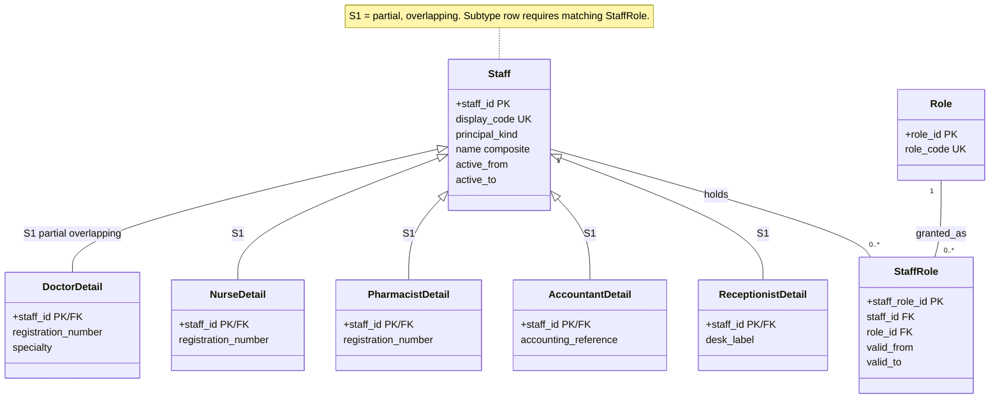

### 3.3 Visit specialization (S2) and Dispensing source specialization (S3)

**S2.** Revision 1 kept `visit_kind`, which duplicated the presence of a `ShortStayEpisode` row, and drew `OPDVisit`/`consultation_context` that existed nowhere else. Both are removed. The OPD aspect has no attributes of its own, so it is a **derived subtype (view `v_opd_visit`)**; `ShortStayEpisode` is the only physical subtype.

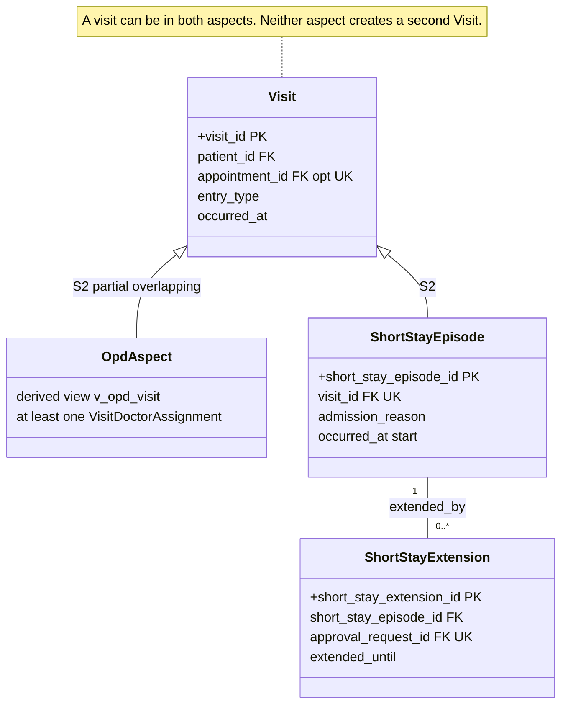

**S3 — Dispensing source `CHECK` matrix** (`counter_sale_id` is required for `outside_prescription` because an outside-prescription sale needs a buyer and a payment path):

| `source_type` | `prescription_item_id` | `outside_prescription_id` | `counter_sale_id` | Other rule |
|---|---|---|---|---|
| `clinic_prescription` | required | NULL | NULL | Billed to the patient's `Bill` via stock-out movements |
| `outside_prescription` | NULL | required | required | Counter customer on the prescription = counter customer on the sale |
| `otc` | NULL | NULL | required | Medicine `schedule_class` must be `none` (Schedule H/H1/X blocked) |

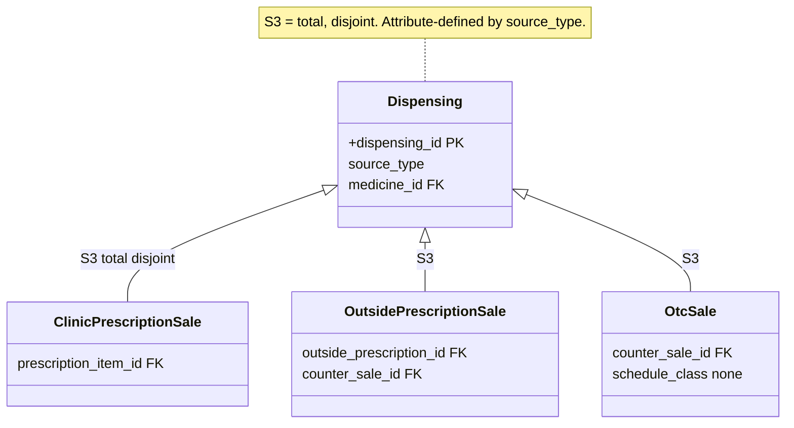

### 3.4 Weak entities and identifying relationships

Seven entities are formally **weak**: each has no meaning without its owner, is naturally sequenced per owner, and is identified by owner key + partial key. A surrogate PK may be added physically, but `UNIQUE(owner_id, partial_key)` must stay. The partial key is assigned by the creating procedure while it holds the owner row's lock (so concurrent inserts cannot collide).

| Weak entity | Owner | Identifying relationship | Partial key | Participation (weak side) |
|---|---|---|---|---|
| PatientPhone | Patient | Patient *has* phone | `phone_sequence` | total |
| AppointmentStatusHistory | Appointment | Appointment *goes through* status | `status_seq` | total |
| VisitStatusHistory | Visit | Visit *goes through* status | `status_seq` | total |
| VitalsObservation | Visit | Visit *is observed by* | `observation_seq` | total |
| PrescriptionLine | Prescription | Prescription *consists of* line | `line_no` | total |
| ClinicalOrderItem | ClinicalOrder | Order *consists of* item | `item_no` | total |
| BillLine | Bill | Bill *consists of* line | `line_no` | total |

Tables that reference a weak entity use its retained surrogate key (`prescription_line_id`, `clinical_order_item_id`, `bill_line_id`, …); diagrams draw the identifying composite.

Other child events (Payment, StockMovement, DoseAdministration, status events of orders and lab orders, …) are **not** weak: each is an independently reconciled, separately audited fact with its own event key and often more than one parent (a `DoseAdministration` is tied to an order item *and* a supply). Mermaid convention: solid `--` = identifying, dotted `..` = ordinary.

### 3.5 Associative (aggregated) entities

| Associative entity | Resolves | Why it is an entity |
|---|---|---|
| StaffRole | Staff × Role | validity dates, granting person |
| MedicineIngredient | Medicine × Ingredient | strength per ingredient (combination drugs) |
| PrescriptionItem | PrescriptionVersion × PrescriptionLine | per-version content and `item_change` |
| AppointmentSlotClaim | Appointment × AppointmentSlot | events over time (reschedule) |
| OrderItemSupply | ClinicalOrderItem × Dispensing | allocated quantity; R6.2 scope marker |
| CustodyHandoff | Dispensing × giver × recipient (**ternary**, §5) | quantity, purpose, acknowledgement |

## 4. Relationship cardinality and participation

Reading rule for `A — B | x : y`: **x** = how many A relate to one B; **y** = how many B relate to one A (same as the crow's-foot markers). **T** = total participation, **P** = partial. Foreign keys sit on the "many" side unless noted.

### 4.1 Identity and access

| Relationship | Cardinality | Participation | Notes |
|---|---|---|---|
| Patient — PatientPhone | 1 : 0..* | phone T (identifying), patient P | partial key `phone_sequence` |
| Patient — PatientAttendant / PatientAllergy / PatientBloodGroup | 1 : 0..* each | child T, patient P | |
| PatientAllergy — PatientAllergyStatusEvent | 1 : 0..* | event T | latest row = current |
| Ingredient — PatientAllergy | 0..1 : 0..* | allergy P | free text allowed instead |
| Patient — PatientMergeLog | as source 1 : 0..1; as survivor 1 : 0..* | log T on both ends | source `UNIQUE`; source ≠ survivor |
| CounterCustomer — CounterCustomerLinkEvent — Patient | 1 : 0..* ; 1 : 0..* | link T on both | audited, human-confirmed |
| Staff — StaffRole — Role | M : N | StaffRole T | human staff ≥ 1 role |
| Staff — *Detail (S1) | 1 : 0..1 each | detail T, staff P | partial, overlapping |

### 4.2 Scheduling, visit flow, short stay, discharge

| Relationship | Cardinality | Participation | Notes |
|---|---|---|---|
| Staff(doctor) — DoctorSchedule | 1 : 0..* | schedule T | |
| DoctorSchedule — DoctorSchedule (*supersedes*) | 0..1 : 0..1 | both P | versions |
| DoctorSchedule — AppointmentSlot | 1 : 0..* | slot T | `UNIQUE(doctor, slot_start)` |
| Appointment — AppointmentSlotClaim — AppointmentSlot | M : N over time | claim T | live claim ≤ 1 per slot (trigger + lock, §10.F) |
| Staff(doctor) — ScheduleChangeRequest | 1 : 0..* | request T | |
| DoctorSchedule — ScheduleChangeRequest (*target*) | 0..1 : 0..* | request P | required for modify/withdraw |
| ScheduleChangeRequest — ScheduleChangeApplication | 1 : 0..1 | application T | pending = no application |
| ScheduleChangeApplication — DoctorSchedule (*resulting*) | 0..1 : 0..1 | P | iff applied |
| Patient — Appointment; Staff(doctor) — Appointment | 1 : 0..* each | appointment T | |
| Appointment — AppointmentStatusHistory | 1 : 1..* | history T (identifying) | first row at booking |
| Appointment — Visit | 0..1 : 0..1 | both P | walk-in has none; cancelled booking has no visit |
| Patient — Visit | 1 : 0..* | visit T | |
| Visit — VisitDoctorAssignment — Staff(doctor) | 1 : 0..* ; 1 : 0..* | assignment T | OPD aspect ⇔ ≥ 1 |
| Visit — VisitStatusHistory | 1 : 1..* | history T (identifying) | first row at creation |
| Visit — VisitClosure | 1 : 0..* | closure T | reversal needs approval |
| Visit — ShortStayEpisode | 1 : 0..1 | episode T, visit P | S2 |
| ShortStayEpisode — ShortStayExtension | 1 : 0..* | extension T | |
| ShortStayEpisode — ShortStayClosure | 1 : 0..* | closure T | |
| Visit — VitalsObservation | 1 : 0..* | observation T (identifying) | |
| ShortStayEpisode — VitalsObservation | 0..1 : 0..* | P | same visit (composite FK) |
| Visit — ClinicalSignoff | 1 : 0..* | signoff T | |
| Visit — ClinicalEmergencyOverride | 1 : 0..* | override T | |
| Visit — Discharge | 1 : 0..1 | discharge T, visit P | |
| ClinicalSignoff — Discharge | 1 : 0..1 | discharge T | sign-off mandatory |
| ClinicalEmergencyOverride — Discharge | 0..1 : 0..1 | P | iff `emergency_override` |
| Visit/Bill — DuePromise | 1 : 0..* each | promise T | |

### 4.3 Clinical notes, prescriptions, orders

| Relationship | Cardinality | Participation | Notes |
|---|---|---|---|
| Visit — ClinicalNote / Diagnosis | 1 : 0..* each | child T | amendments via `corrects_id` |
| Visit — Prescription | 1 : 0..* | prescription T | |
| Prescription — PrescriptionVersion | 1 : 1..* | version T | |
| Prescription — PrescriptionLine | 1 : 1..* | line T (identifying) | |
| PrescriptionVersion — PrescriptionItem — PrescriptionLine | 1 : 1..* ; 1 : 0..* | item T | every version snapshots every line |
| PrescriptionLine — PrescriptionLineStatus | 1 : 1..* | status T | initial `prescribed` |
| Medicine — PrescriptionItem | 0..1 : 0..* | item P | else free text |
| PrescriptionItem — AllergyConfirmation | 1 : 0..* | T | required for free-text and warned catalog items |
| PrescriptionItem — CatalogReviewQueue — CatalogReviewEvent | 1 : 0..* ; 1 : 0..* | T | |
| Visit — ClinicalOrder | 1 : 0..* | order T | |
| ShortStayEpisode — ClinicalOrder | 0..1 : 0..* | P | |
| ClinicalOrder — ClinicalOrderStatus | 1 : 1..* | T | |
| ClinicalOrder — ClinicalOrderItem | 1 : 1..* | item T (identifying) | |
| ClinicalOrderItem — ClinicalOrderItemStatus | 1 : 1..* | T | item-level stop/change |
| ClinicalOrderItem — ClinicalOrderItem (*supersedes*) | 0..1 : 0..1 | P | |
| ClinicalOrderItem — DoseAdministration | 1 : 0..* | dose T | |
| OrderItemSupply — DoseAdministration | 0..1 : 0..* | dose P | required when `quantity_consumed > 0`; composite FK keeps item and supply consistent |

### 4.4 Pharmacy, custody, counter sales

| Relationship | Cardinality | Participation | Notes |
|---|---|---|---|
| Medicine — MedicineIngredient — Ingredient | M : N | link T | |
| Medicine — StockBatch | 1 : 0..* | batch T | |
| Supplier — StockBatch | 0..1 : 0..* | batch P | optional |
| StockBatch — StockMovement | 1 : 0..* | movement T | |
| Dispensing — StockMovement (stock-out) | 0..1 : 1..* | dispensing T on movement side | each dispensing ≥ 1 stock-out movement |
| StockMovement — StockMovement (*returns*, *reverses*) | 0..1 : 0..* each | P | typed by `movement_type` |
| Medicine — Dispensing | 1 : 0..* | T | |
| PrescriptionItem / OutsidePrescription / CounterSale — Dispensing | 0..1 : 0..* each | by S3 matrix | exactly one source |
| CounterCustomer — OutsidePrescription / CounterSale | 1 : 0..* each | T | |
| CounterSale — Dispensing | 0..1 : 1..* | sale T on dispensing side | header groups lines |
| CounterSale — CounterSalePayment / CounterSaleReturn / CounterSaleRefund | 1 : 0..* each | T | |
| CounterSaleReturn — StockMovement | 1 : 1 | T | the `returned_by_patient` movement |
| CounterSaleReturn — CounterSaleRefund | 0..1 : 0..* | P | |
| ClinicalOrderItem — OrderItemSupply — Dispensing | M : N | supply T | order-linked dispensing (§5) |
| Dispensing — CustodyHandoff | 1 : 0..* | handoff T | ternary (§5) |
| CustodyHandoff — CustodyHandoffAcknowledgement | 1 : 0..1 | ack T | unacknowledged handoffs do not count toward R6.2 |
| Dispensing — LeftoverReturnRequest — LeftoverReturnDecision | 1 : 0..* ; 1 : 0..1 | T | pending = no decision |
| LeftoverReturnDecision — StockMovement | 0..1 : 0..1 | P | iff accepted |
| LeftoverReturnDecision — CustodyHandoff | 0..1 : 0..* | P | refused → family handover |
| Staff(pharmacist) — CashHandoverDeclaration — CashHandoverCount — Staff(accountant) | 1 : 0..* ; 1 : 0..1 | T | two actors, two events |

### 4.5 Laboratory

| Relationship | Cardinality | Participation | Notes |
|---|---|---|---|
| Visit — LabOrder; OutsideLab — LabOrder | 1 : 0..* each | order T | |
| ClinicalOrder — LabOrder | 0..1 : 0..* | P | |
| LabOrder — LabOrderStatus | 1 : 1..* | T | first row `ordered` |
| LabOrder — LabOrderPrice | 1 : 0..* | T | |
| LabOrder — LabReport | 1 : 0..* | report T | versions |
| LabReport — LabReport (*supersedes*) | 0..1 : 0..1 | P | |
| LabReport — LabReportIdentifierCheck | 1 : 2..* | T | ≥ 2 matched kinds to attach |
| LabReport — LabReportCriticalMark / LabReportReview / LabReportRetraction | 1 : 0..* each | T | |
| PatientBloodGroup — LabReport | 0..1 : 0..* | P | when `lab_confirmed` |

### 4.6 Billing, approvals, discharge money

| Relationship | Cardinality | Participation | Notes |
|---|---|---|---|
| Visit — Bill | 1 : 0..1 | bill T | one bill per visit (V1) |
| Bill — BillLine | 1 : 0..* | line T (identifying) | |
| Bill — BillFinalization | 1 : 0..1 | T | |
| Bill — Payment / Refund | 1 : 0..* each | T | |
| PriceList — BillLine | 0..1 : 0..* | P | |
| StockMovement / LabOrder / ShortStayEpisode — BillLine | 0..1 : 0..* each | P | line generated from the event |
| BillLine — BillLine (*reverses*) | 0..1 : 0..1 | P | |
| BillLine — Refund (*credit line*) | 0..1 : 0..* | P | |
| ApprovalRequest — ApprovalDecision | 1 : 0..1 | decision T | |
| AuthorityDelegation — ApprovalDecision | 0..1 : 0..* | P | when approver is a delegate |
| ApprovalRequest — target (§2.7 catalog) | 1 : 0..1 per target type | target T for gated actions | **target holds the FK** |

### 4.7 Audit, alerts, family access

| Relationship | Cardinality | Participation | Notes |
|---|---|---|---|
| AlertEvent — AlertAcknowledgement / AlertEscalation | 1 : 0..* each | T | |
| AuthorityDelegation — AuthorityDelegationRevocation | 1 : 0..* | T | |
| Visit — FamilyLink | 1 : 0..* | link T | one visit/stay per link |
| PatientAttendant — FamilyLink | 0..1 : 0..* | P | consent recipient |
| FamilyLink — FamilyLinkRevocation / LinkAccessLog | 1 : 0..* ; 0..1 : 0..* | log P (unknown token) | |
| FamilyLink / Payment / CounterSalePayment / DuePromise — MessageOutbox | 0..1 : 0..* each | P | typed FKs |
| MessageOutbox — MessageDeliveryEvent | 1 : 0..* | T | |
| Staff — every E entity (`recorded_by`, `recorded_by_role`) | 1 : 0..* | T | the G5 accountability edge; not drawn in subject diagrams |

## 5. Ternary relationship and the R6.2 reconciliation scope

### 5.1 CustodyHandoff — the ternary that genuinely fits

**CustodyHandoff** relates three participants at once: a **Dispensing**, the **giver** (Staff, always the person who records it — `CHECK giver_staff_id = recorded_by`, G1) and a **recipient** that is either a Staff member (usually a nurse) or a `PatientAttendant` (family). It cannot be decomposed into two binary relationships without losing *who gave which dispensing's medicine to whom*. Exactly one recipient FK is set; the recipient type is derived, not stored. The same dispensing can be handed over in several portions.

**Recipient acknowledgement (G1).** The giver alone no longer proves custody moved. `CustodyHandoffAcknowledgement` is recorded by the recipient side: a staff recipient logs in and acknowledges themselves; for a family recipient (no login in V1) a staff member who is **not the giver** witnesses and records it (CR-4). An unacknowledged handoff does **not** count in the R6.2 equation, so it blocks discharge until fixed.

### 5.2 R6.2 scope and equation

**Scope (explicit).** The equation applies **only to order-linked dispensings** — those with at least one net `OrderItemSupply` row. OPD, take-home, outside-prescription and OTC dispensings have no doses, are **out of scope**, and never block discharge on R6.2. An order-linked dispensing must be **fully allocated** (`Σ quantity_allocated = quantity dispensed`), and `take_home` handoffs are not allowed on it.

For each order-linked dispensing *D* (all quantities in stock units):

```
dispensed(D)  =  Σ DoseAdministration.quantity_consumed   (via D's OrderItemSupply rows)
              +  Σ accepted LeftoverReturnDecision → returned_by_patient StockMovement quantity
              +  Σ acknowledged CustodyHandoff.quantity with purpose 'leftover_to_family'
```

Any mismatch blocks the discharge checklist (R9.4). Staff-to-staff handoffs (`supply_to_nurse`) record custody transfer only and are **not** a term. A dose's supply must belong to the dose's own order item — enforced declaratively by the composite FK `(order_item_supply_id, clinical_order_item_id)`. Dropped or spoiled units are not a fourth term under the current rule; see **CR-1**.

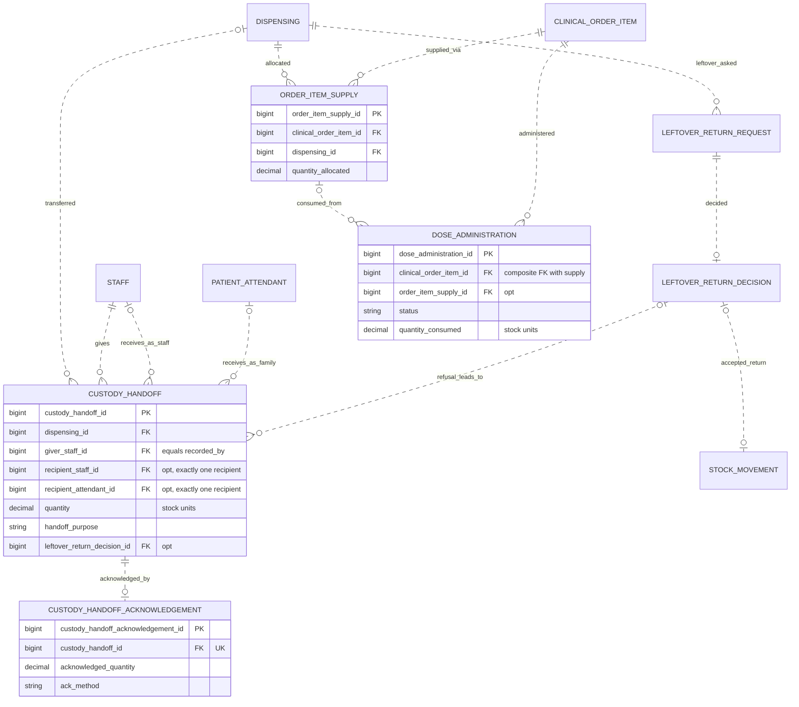

## 6. Subject-area diagrams

Seven subject areas map to the card's list (identity, scheduling, clinical orders, pharmacy, billing, audit) with laboratory split out for readability. Repeated entities across diagrams are references to the same logical entity. The overview shows the cross-area **spine** only; trail/event children appear in their subject area.

### 6.1 Overview

```mermaid
erDiagram
    PATIENT ||..o{ VISIT : attends
    PATIENT ||..o{ APPOINTMENT : books
    STAFF ||..o{ STAFF_ROLE : holds
    ROLE ||..o{ STAFF_ROLE : granted_as
    STAFF ||..o{ DOCTOR_SCHEDULE : works
    DOCTOR_SCHEDULE ||..o{ APPOINTMENT_SLOT : generates
    STAFF ||..o{ APPOINTMENT : doctor_of
    APPOINTMENT ||..|{ APPOINTMENT_SLOT_CLAIM : holds
    APPOINTMENT_SLOT ||..o{ APPOINTMENT_SLOT_CLAIM : offered_as
    APPOINTMENT |o..o| VISIT : leads_to
    VISIT ||..o{ VISIT_DOCTOR_ASSIGNMENT : attended_by
    VISIT ||--|{ VISIT_STATUS_HISTORY : flows
    VISIT ||--o{ VITALS_OBSERVATION : observed
    VISIT ||..o| SHORT_STAY_EPISODE : may_gain
    SHORT_STAY_EPISODE ||..o{ SHORT_STAY_EXTENSION : extended_by
    VISIT ||..o| DISCHARGE : ends_with
    VISIT ||..o{ PRESCRIPTION : prescribed
    PRESCRIPTION ||..|{ PRESCRIPTION_VERSION : versioned
    PRESCRIPTION ||--|{ PRESCRIPTION_LINE : consists_of
    PRESCRIPTION_VERSION ||..|{ PRESCRIPTION_ITEM : snapshots
    PRESCRIPTION_LINE ||..o{ PRESCRIPTION_ITEM : lineage
    VISIT ||..o{ CLINICAL_ORDER : orders
    CLINICAL_ORDER ||--|{ CLINICAL_ORDER_ITEM : consists_of
    CLINICAL_ORDER_ITEM ||..o{ DOSE_ADMINISTRATION : administered
    CLINICAL_ORDER_ITEM ||..o{ ORDER_ITEM_SUPPLY : supplied_via
    DISPENSING ||..o{ ORDER_ITEM_SUPPLY : allocated
    ORDER_ITEM_SUPPLY |o..o{ DOSE_ADMINISTRATION : consumed_from
    MEDICINE ||..o{ STOCK_BATCH : batches
    STOCK_BATCH ||..o{ STOCK_MOVEMENT : ledger
    DISPENSING |o..|{ STOCK_MOVEMENT : stock_out
    MEDICINE ||..o{ DISPENSING : of
    PRESCRIPTION_ITEM |o..o{ DISPENSING : clinic_source
    OUTSIDE_PRESCRIPTION |o..o{ DISPENSING : outside_source
    COUNTER_SALE |o..|{ DISPENSING : sale_lines
    COUNTER_CUSTOMER ||..o{ COUNTER_SALE : buys
    COUNTER_CUSTOMER ||..o{ OUTSIDE_PRESCRIPTION : presents
    COUNTER_SALE ||..o{ COUNTER_SALE_PAYMENT : paid_by
    DISPENSING ||..o{ CUSTODY_HANDOFF : custody
    VISIT ||..o{ LAB_ORDER : requests
    OUTSIDE_LAB ||..o{ LAB_ORDER : processes
    LAB_ORDER ||..o{ LAB_REPORT : receives
    LAB_REPORT ||..o{ LAB_REPORT_REVIEW : reviewed_by
    VISIT ||..o| BILL : billed_in
    BILL ||--o{ BILL_LINE : consists_of
    STOCK_MOVEMENT |o..o{ BILL_LINE : prices
    BILL ||..o{ PAYMENT : paid_by
    BILL ||..o{ REFUND : refunded_by
    APPROVAL_REQUEST ||..o| APPROVAL_DECISION : decided_by
    APPROVAL_REQUEST |o..o| BILL_LINE : authorizes
    APPROVAL_REQUEST |o..o| REFUND : authorizes
    APPROVAL_REQUEST |o..o| STOCK_MOVEMENT : authorizes
    APPROVAL_REQUEST |o..o| SHORT_STAY_EXTENSION : authorizes
    APPROVAL_REQUEST |o..o| DISCHARGE : authorizes
    VISIT ||..o{ FAMILY_LINK : shared_via
    FAMILY_LINK ||..o{ LINK_ACCESS_LOG : attempts
    ALERT_EVENT ||..o{ ALERT_ACKNOWLEDGEMENT : acknowledged
    STAFF ||..o{ AUDIT_LOG : recorded_by
```

### 6.2 Identity and access

```mermaid
erDiagram
    PATIENT ||--o{ PATIENT_PHONE : has
    PATIENT ||..o{ PATIENT_ATTENDANT : has
    PATIENT ||..o{ PATIENT_ALLERGY : allergic_history
    PATIENT_ALLERGY ||..o{ PATIENT_ALLERGY_STATUS_EVENT : status_events
    INGREDIENT |o..o{ PATIENT_ALLERGY : named_in
    PATIENT ||..o{ PATIENT_BLOOD_GROUP : clinical_record
    PATIENT ||..o| PATIENT_MERGE_LOG : merged_away_as_source
    PATIENT ||..o{ PATIENT_MERGE_LOG : survivor_in
    COUNTER_CUSTOMER ||..o{ COUNTER_CUSTOMER_LINK_EVENT : link_history
    PATIENT ||..o{ COUNTER_CUSTOMER_LINK_EVENT : linked_to
    STAFF ||..o{ STAFF_ROLE : holds
    ROLE ||..o{ STAFF_ROLE : granted_as
    STAFF ||..o| DOCTOR_DETAIL : subtype
    STAFF ||..o| NURSE_DETAIL : subtype
    STAFF ||..o| PHARMACIST_DETAIL : subtype
    STAFF ||..o| ACCOUNTANT_DETAIL : subtype
    STAFF ||..o| RECEPTIONIST_DETAIL : subtype
    PATIENT {
        bigint patient_id PK
        string display_code UK
        string registration_kind
        string given_name "composite name"
        string family_name "composite name"
        date date_of_birth "opt"
        int approximate_age "opt"
        string aadhaar_last4 "opt"
        string permanent_address "composite"
        string temporary_address "composite"
    }
    PATIENT_PHONE {
        bigint patient_id PK, FK
        int phone_sequence PK "partial key"
        string phone_number
        datetime valid_from
        datetime valid_to
    }
    PATIENT_ALLERGY {
        bigint patient_allergy_id PK
        bigint patient_id FK
        bigint ingredient_id FK "opt"
        string allergen_text "opt"
        string severity
    }
    PATIENT_BLOOD_GROUP {
        bigint patient_blood_group_id PK
        bigint patient_id FK
        string abo_group
        string rh_factor
        string source
    }
    PATIENT_MERGE_LOG {
        bigint patient_merge_log_id PK
        bigint source_patient_id FK "UK"
        bigint surviving_patient_id FK
        string suggested_match_tier
    }
    STAFF {
        bigint staff_id PK
        string display_code UK
        string principal_kind "human or system"
        string login_subject UK "null for system"
    }
    ROLE {
        bigint role_id PK
        string role_code UK
    }
    STAFF_ROLE {
        bigint staff_role_id PK
        bigint staff_id FK
        bigint role_id FK
        datetime valid_from
        datetime valid_to
    }
```

### 6.3 Scheduling, visit flow, short stay and discharge

```mermaid
erDiagram
    STAFF ||..o{ DOCTOR_SCHEDULE : works
    DOCTOR_SCHEDULE |o..o| DOCTOR_SCHEDULE : superseded_by
    DOCTOR_SCHEDULE ||..o{ APPOINTMENT_SLOT : generates
    DOCTOR_SCHEDULE |o..o{ SCHEDULE_CHANGE_REQUEST : targeted_by
    SCHEDULE_CHANGE_REQUEST ||..o| SCHEDULE_CHANGE_APPLICATION : applied_by
    SCHEDULE_CHANGE_APPLICATION |o..o| DOCTOR_SCHEDULE : resulting
    PATIENT ||..o{ APPOINTMENT : books
    STAFF ||..o{ APPOINTMENT : doctor_of
    APPOINTMENT ||..|{ APPOINTMENT_SLOT_CLAIM : holds
    APPOINTMENT_SLOT ||..o{ APPOINTMENT_SLOT_CLAIM : offered_as
    APPOINTMENT ||--|{ APPOINTMENT_STATUS_HISTORY : goes_through
    APPOINTMENT |o..o| VISIT : leads_to
    PATIENT ||..o{ VISIT : attends
    VISIT ||..o{ VISIT_DOCTOR_ASSIGNMENT : attended_by
    VISIT ||--|{ VISIT_STATUS_HISTORY : goes_through
    VISIT ||..o{ VISIT_CLOSURE : closed_by
    VISIT ||..o| SHORT_STAY_EPISODE : may_gain
    SHORT_STAY_EPISODE ||..o{ SHORT_STAY_EXTENSION : extended_by
    SHORT_STAY_EPISODE ||..o{ SHORT_STAY_CLOSURE : closed_by
    VISIT ||--o{ VITALS_OBSERVATION : observed
    SHORT_STAY_EPISODE |o..o{ VITALS_OBSERVATION : during
    VISIT ||..o{ CLINICAL_SIGNOFF : signed_off
    VISIT ||..o{ CLINICAL_EMERGENCY_OVERRIDE : overridden
    VISIT ||..o| DISCHARGE : ends_with
    CLINICAL_SIGNOFF ||..o| DISCHARGE : required_by
    CLINICAL_EMERGENCY_OVERRIDE |o..o| DISCHARGE : bypass_basis
    VISIT ||..o{ DUE_PROMISE : promised
    DOCTOR_SCHEDULE {
        bigint doctor_schedule_id PK
        bigint doctor_staff_id FK
        int weekday
        time start_time
        time end_time
        int slot_minutes
        date valid_from
        string schedule_state
    }
    APPOINTMENT_SLOT {
        bigint appointment_slot_id PK
        bigint doctor_schedule_id FK
        bigint doctor_staff_id FK "UK with slot_start"
        datetime slot_start "UK with doctor"
        datetime slot_end
    }
    APPOINTMENT {
        bigint appointment_id PK
        bigint patient_id FK
        bigint doctor_staff_id FK
        string booking_channel
    }
    APPOINTMENT_SLOT_CLAIM {
        bigint appointment_slot_claim_id PK
        bigint appointment_id FK
        bigint appointment_slot_id FK
        string claim_reason
    }
    APPOINTMENT_STATUS_HISTORY {
        bigint appointment_id PK, FK
        int status_seq PK "partial key"
        string status
    }
    VISIT {
        bigint visit_id PK
        bigint patient_id FK
        bigint appointment_id FK "opt UK"
        string entry_type
    }
    VISIT_STATUS_HISTORY {
        bigint visit_id PK, FK
        int status_seq PK "partial key"
        string status
        string location_label
    }
    VITALS_OBSERVATION {
        bigint visit_id PK, FK
        int observation_seq PK "partial key"
        string observation_type
        decimal numeric_value
        string unit
    }
    SHORT_STAY_EPISODE {
        bigint short_stay_episode_id PK
        bigint visit_id FK "UK"
        string admission_reason
    }
    SHORT_STAY_EXTENSION {
        bigint short_stay_extension_id PK
        bigint short_stay_episode_id FK
        bigint approval_request_id FK "UK"
        datetime extended_until
    }
    DISCHARGE {
        bigint discharge_id PK
        bigint visit_id FK "UK"
        bigint clinical_signoff_id FK
        string financial_gate_basis
        bigint approval_request_id FK "opt"
        bigint clinical_emergency_override_id FK "opt"
    }
```

### 6.4 Clinical orders: notes, prescriptions, orders, doses

Weak entities show their identifying composite (`owner PK, FK` + partial key). Tables that reference a weak entity use its retained surrogate key (§3.4).

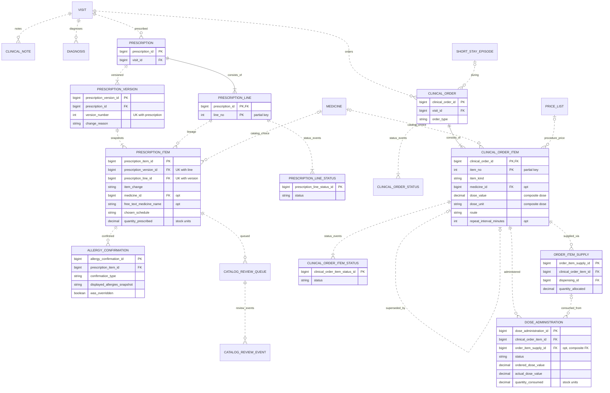

### 6.5 Pharmacy, inventory, custody and counter sales

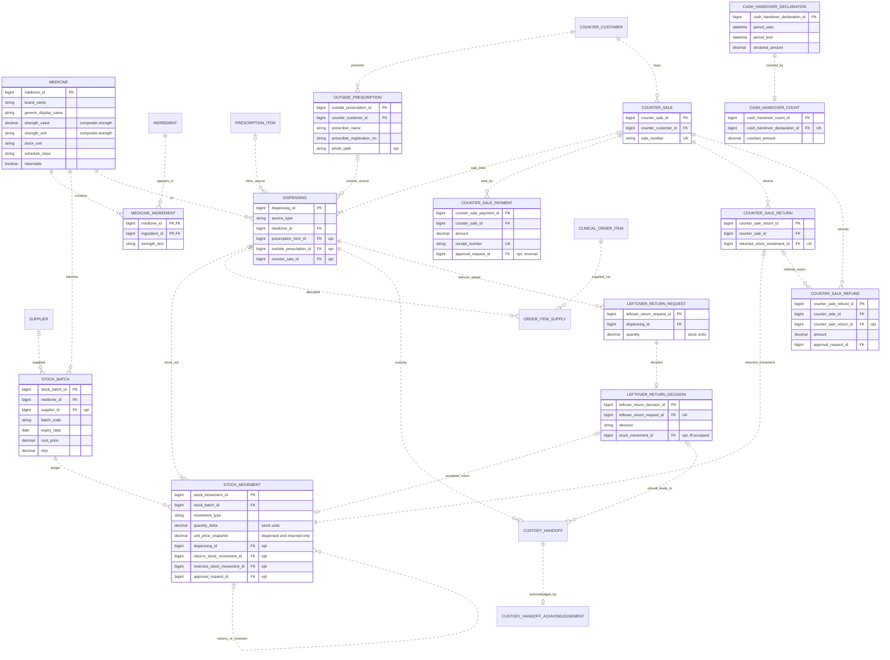

### 6.6 Laboratory (outside labs only)

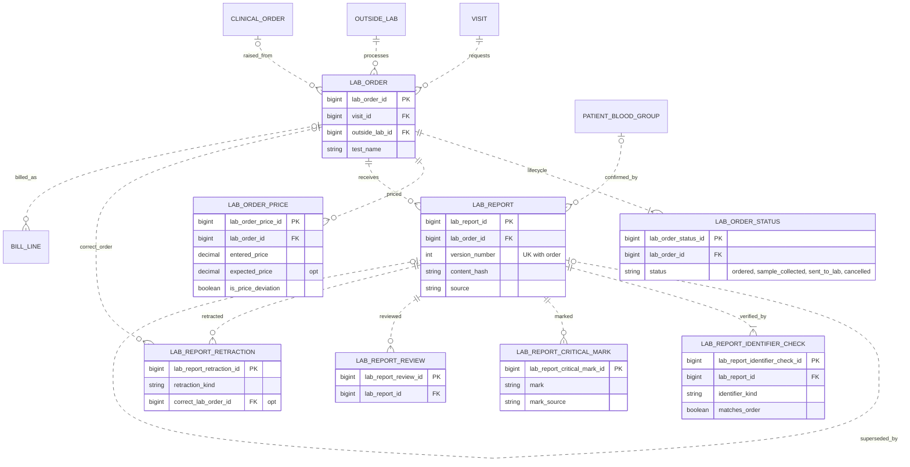

### 6.7 Billing and payments

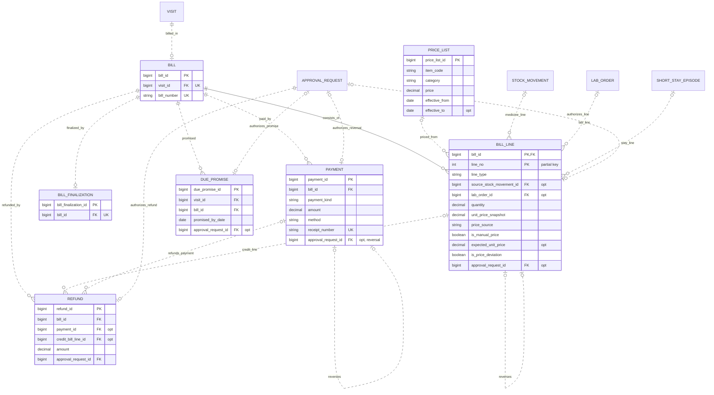

### 6.8 Audit, approvals, alerts, family access, messaging and operations

```mermaid
erDiagram
    APPROVAL_REQUEST ||..o| APPROVAL_DECISION : decided_by
    AUTHORITY_DELEGATION |o..o{ APPROVAL_DECISION : authority_basis
    AUTHORITY_DELEGATION ||..o{ AUTHORITY_DELEGATION_REVOCATION : revoked_by
    APPROVAL_REQUEST |o..o| BILL_LINE : authorizes_line
    APPROVAL_REQUEST |o..o| REFUND : authorizes_refund
    APPROVAL_REQUEST |o..o| PAYMENT : authorizes_reversal
    APPROVAL_REQUEST |o..o| STOCK_MOVEMENT : authorizes_adjustment
    APPROVAL_REQUEST |o..o| COUNTER_SALE_REFUND : authorizes_refund
    APPROVAL_REQUEST |o..o| COUNTER_SALE_PAYMENT : authorizes_reversal
    APPROVAL_REQUEST |o..o| VISIT_CLOSURE : authorizes_reopen
    APPROVAL_REQUEST |o..o| SHORT_STAY_EXTENSION : authorizes_extension
    APPROVAL_REQUEST |o..o| DISCHARGE : authorizes_partial_payment
    APPROVAL_REQUEST |o..o| DUE_PROMISE : authorizes_promise
    STAFF ||..o{ AUDIT_LOG : recorded_by
    STAFF |o..o{ LOGIN_SESSION_EVENT : session_of
    ALERT_EVENT ||..o{ ALERT_ACKNOWLEDGEMENT : acknowledged
    ALERT_EVENT ||..o{ ALERT_ESCALATION : escalated
    STAFF ||..o{ ALERT_ESCALATION : escalated_to
    VISIT ||..o{ FAMILY_LINK : shared_via
    PATIENT_ATTENDANT |o..o{ FAMILY_LINK : received_by
    FAMILY_LINK |o..o{ LINK_ACCESS_LOG : attempts
    FAMILY_LINK ||..o{ FAMILY_LINK_REVOCATION : revoked_by
    FAMILY_LINK |o..o{ MESSAGE_OUTBOX : notified_by
    PAYMENT |o..o{ MESSAGE_OUTBOX : receipt_for
    COUNTER_SALE_PAYMENT |o..o{ MESSAGE_OUTBOX : receipt_for
    DUE_PROMISE |o..o{ MESSAGE_OUTBOX : reminder_for
    MESSAGE_OUTBOX ||..o{ MESSAGE_DELIVERY_EVENT : delivery
    BACKUP_RUN |o..o{ BACKUP_RUN : restore_drill_of
    APPROVAL_REQUEST {
        bigint approval_request_id PK
        string request_type
        bigint visit_id FK "opt context"
        bigint bill_id FK "opt context"
        bigint stock_batch_id FK "opt context"
        bigint short_stay_episode_id FK "opt context"
        bigint counter_sale_id FK "opt context"
        decimal requested_amount "payload"
        decimal requested_quantity "payload"
        string proposed_change "payload"
        string reason
    }
    APPROVAL_DECISION {
        bigint approval_decision_id PK
        bigint approval_request_id FK "UK"
        string decision
        string decision_channel
        bigint authority_delegation_id FK "opt"
    }
    AUTHORITY_DELEGATION {
        bigint authority_delegation_id PK
        bigint delegate_staff_id FK
        string scope
        decimal limit_amount "opt"
        datetime valid_from
        datetime valid_to
    }
    AUDIT_LOG {
        bigint audit_log_id PK
        string action
        string entity_type "soft reference"
        bigint entity_id "soft reference"
        json old_values
        json new_values
    }
    ALERT_EVENT {
        bigint alert_event_id PK
        string alert_class
        string alert_type
        string severity
        string source_entity_type "soft reference"
        bigint source_entity_id "soft reference"
    }
    LOGIN_SESSION_EVENT {
        bigint login_session_event_id PK
        bigint staff_id FK "opt"
        string login_identifier
        string event_type
    }
    FAMILY_LINK {
        bigint family_link_id PK
        bigint visit_id FK
        string token_hash UK
        string second_factor_kind
        string printed_code_hash "opt, iff printed_code"
        datetime expires_at
    }
    LINK_ACCESS_LOG {
        bigint link_access_log_id PK
        bigint family_link_id FK "opt"
        string token_fingerprint
        boolean success
    }
    MESSAGE_OUTBOX {
        bigint message_outbox_id PK
        string message_type
        string safe_template_key
        bigint family_link_id FK "opt"
        bigint payment_id FK "opt"
    }
    BACKUP_RUN {
        bigint backup_run_id PK
        string backup_kind
        bigint restored_from_backup_run_id FK "opt"
    }
    BENCHMARK_RUN {
        bigint benchmark_run_id PK
        int dataset_size
        string query_name
    }
    CLINIC_SETTINGS {
        string setting_key PK
        string setting_value
        string value_type
    }
    ID_COUNTER {
        string counter_name PK
        bigint next_value
        string display_prefix
    }
```

## 7. Design for a large enterprise

V1 is one MySQL database for one clinic, built as a modular monolith. The model is already cut into **subject areas** so growth never has to untangle unrelated rules. The areas are *logical bounded contexts*, not a plan to introduce microservices.

| Area | Owns | Exposes to other areas (by ID only) |
|---|---|---|
| **1 Identity and access** | Patient and history children, PatientMergeLog, CounterCustomer, Staff/Role/StaffRole, subtype details, system principals | `patient_id`, `staff_id`, role context |
| **2 Scheduling and visit flow** | DoctorSchedule, AppointmentSlot/Claim, Appointment, Visit and its trails, ShortStay*, Vitals, ClinicalSignoff, Discharge | `visit_id`, `short_stay_episode_id` |
| **3 Clinical orders** | Notes, Diagnosis, Prescription/Version/Line/Item, ClinicalOrder/Item and status trails, DoseAdministration, AllergyConfirmation | `prescription_item_id`, `clinical_order_item_id` |
| **4 Pharmacy and inventory** | Medicine catalog, Ingredient, StockBatch/Movement, Dispensing, OrderItemSupply, Custody*, Leftover*, CounterSale*, CashHandover* | `dispensing_id`, `stock_movement_id` |
| **4b Laboratory** | OutsideLab, LabOrder and children | `lab_order_id`, `lab_report_id` |
| **5 Billing** | PriceList, Bill, BillLine, Payment, Refund, DuePromise | `bill_id` |
| **6 Audit, control and operations** | ApprovalRequest/Decision, AuthorityDelegation, AuditLog, AlertEvent trail, LoginSessionEvent, FamilyLink, MessageOutbox, ClinicSettings, IdCounter, BackupRun, BenchmarkRun | `approval_request_id`, alerts |

**Rules that make a later split safe:** areas reference each other only through IDs and append-only events (never through shared mutable columns); each cross-area fact is an event with `request_uuid` (idempotent replay); billing reads pharmacy and lab *events* (stock-out movements, lab orders) instead of copying them; one transaction boundary is kept for the operations that must be atomic (dispense + stock-out movement, accepted return + credit line, discharge + visit/stay/bill closure, merge). Before splitting, durable event contracts, reconciliation and identity propagation must exist. Multi-clinic growth stays **one database per clinic with the same schema** (R13.1); `ClinicSettings` and clinic-coded display IDs keep that open, and no `clinic_id` column exists.

## 8. Business-rule traceability: every R-number to supporting entities

"Support" means the model provides the data and relationships; many rules additionally need triggers, procedures, grants/views, transactions or workflow (§10). Entities in *italics* are derived views.

| Rule | Supporting entities / model elements |
|---|---|
| **R1.1** | Patient, IdCounter, ClinicSettings |
| **R1.2** | Patient, PatientPhone, PatientAllergy, PatientAllergyStatusEvent, PatientAttendant |
| **R1.3** | Patient (`aadhaar_last4`), PatientBloodGroup |
| **R1.4** | Patient, PatientPhone, PatientAttendant, PatientMergeLog (`suggested_match_tier`), AuditLog |
| **R1.5** | Patient (`registration_kind`, `TMP-` code), IdCounter, PatientMergeLog (derived merged-away marker), AuditLog; physical move-vs-redirect: CR-2 |
| **R1.6** | Patient, AuditLog, ClinicalNote, Diagnosis, PrescriptionVersion, PatientAllergyStatusEvent, LabReport |
| **R2.1** | Staff, Role, StaffRole, DoctorDetail, NurseDetail, PharmacistDetail, AccountantDetail, ReceptionistDetail |
| **R2.2** | Role, StaffRole, Staff (system principals), ClinicSettings; role views and grants are DB controls |
| **R2.3** | ApprovalRequest, ApprovalDecision, AuthorityDelegation, AuthorityDelegationRevocation, approval target catalog (§2.7) |
| **R2.4** | Visit, Bill, BillLine, StockMovement, Dispensing, Payment, CounterSalePayment, CashHandoverDeclaration, CashHandoverCount, MessageOutbox, AlertEvent |
| **R2.5** | PrescriptionLine, PrescriptionItem, Dispensing, OrderItemSupply, CustodyHandoff, CustodyHandoffAcknowledgement, DoseAdministration, LeftoverReturnRequest, LeftoverReturnDecision, FamilyLink |
| **R3.1** | Visit, Appointment, ShortStayEpisode |
| **R3.2** | Appointment, AppointmentStatusHistory, AppointmentSlotClaim, Visit |
| **R3.3** | Visit, VisitStatusHistory, VisitDoctorAssignment |
| **R3.4** | ShortStayEpisode, ShortStayExtension, ShortStayClosure, ApprovalRequest, ApprovalDecision, ClinicSettings, AlertEvent |
| **R3.5** | VitalsObservation, NurseDetail, Staff |
| **R3.6** | DoctorSchedule, AppointmentSlot, AppointmentSlotClaim, Appointment, DoctorDetail (lock anchor); trigger + lock, §10.F |
| **R3.7** | DoctorSchedule, ScheduleChangeRequest, ScheduleChangeApplication, AppointmentSlot, AuditLog |
| **R4.1** | Prescription, PrescriptionVersion, PrescriptionLine, PrescriptionItem |
| **R4.2** | Medicine, StockBatch, StockMovement, PrescriptionItem |
| **R4.3** | Medicine, PrescriptionItem, ClinicalOrderItem |
| **R4.4** | PatientAllergy, Ingredient, MedicineIngredient, Medicine, PrescriptionItem, AllergyConfirmation, AlertEvent |
| **R4.5** | PrescriptionItem, CatalogReviewQueue, CatalogReviewEvent, Medicine, AuditLog |
| **R4.6** | PrescriptionLine, PrescriptionLineStatus, Medicine, StockBatch, StockMovement, AlertEvent |
| **R4.7** | Prescription, PrescriptionVersion, PrescriptionItem, ClinicalOrder, ClinicalOrderStatus, ClinicalOrderItem, ClinicalOrderItemStatus |
| **R5.1** | Medicine, StockBatch, Supplier, StockMovement, Staff |
| **R5.2** | StockMovement, StockBatch |
| **R5.3** | StockMovement, ApprovalRequest, ApprovalDecision, AlertEvent |
| **R5.4** | StockBatch, Medicine, StockMovement, Supplier, ClinicSettings, AlertEvent |
| **R5.5** | Dispensing (S3), PrescriptionItem, OutsidePrescription, CounterSale, CounterCustomer, Medicine (`schedule_class`); source list vs orders: CR-5 |
| **R5.6** | CounterCustomer, CounterCustomerLinkEvent, Patient, AuditLog |
| **R5.7** | CounterSale, CounterSalePayment, CounterSaleReturn, CounterSaleRefund, CashHandoverDeclaration, CashHandoverCount, MessageOutbox, AlertEvent; refund disbursement: CR-3 |
| **R5.8** | Dispensing, CounterSale, Medicine, Staff, PharmacistDetail, OutsidePrescription, AlertEvent, AuditLog |
| **R6.1** | DoseAdministration, ClinicalOrderItem, NurseDetail, AlertEvent |
| **R6.2** | Dispensing, OrderItemSupply, DoseAdministration, LeftoverReturnDecision, StockMovement, CustodyHandoff, CustodyHandoffAcknowledgement, Discharge (checklist); scope in §5.2; wastage: CR-1 |
| **R6.3** | Medicine (`returnable`), LeftoverReturnRequest, LeftoverReturnDecision, StockMovement, BillLine, Refund, CustodyHandoff, ApprovalRequest, ApprovalDecision |
| **R6.4** | LeftoverReturnRequest, LeftoverReturnDecision, StockMovement, Staff, AlertEvent |
| **R7.1** | OutsideLab, LabOrder, Visit, DoctorDetail |
| **R7.2** | LabOrder, LabOrderStatus, LabReport, LabReportReview (derived five-step trail) |
| **R7.3** | LabReport, LabReportIdentifierCheck, LabReportRetraction, AuditLog |
| **R7.4** | LabReport, LabReportReview, LabReportCriticalMark, ClinicSettings, AlertEvent |
| **R7.5** | LabOrder, LabOrderPrice, BillLine, LabReport, ClinicSettings, AlertEvent |
| **R7.6** | LabReport (hash/version/file hook only; no structured result values) |
| **R8.1** | PriceList, BillLine (`price_source`, `is_manual_price`, `expected_unit_price`, `is_price_deviation`), StockBatch (`mrp`), StockMovement (`unit_price_snapshot`), LabOrderPrice, ClinicSettings |
| **R8.2** | Bill, BillLine, StockMovement, LabOrder, ShortStayEpisode |
| **R8.3** | Bill, BillFinalization, BillLine (post-finalization lines), Payment, Refund, ApprovalRequest |
| **R8.4** | BillLine, ApprovalRequest, ApprovalDecision, AuthorityDelegation |
| **R8.5** | Payment, Refund, Bill, ApprovalRequest, ApprovalDecision, MessageOutbox |
| **R9.1** | Discharge, DuePromise, ApprovalRequest, ApprovalDecision, AuthorityDelegation, Bill, Payment, ClinicSettings |
| **R9.2** | ClinicalEmergencyOverride, Discharge, AlertEvent, AuditLog |
| **R9.3** | DuePromise, *Due*, Bill, Visit, MessageOutbox |
| **R9.4** | Discharge, ClinicalSignoff, VisitClosure, ShortStayClosure, BillFinalization, DoseAdministration, LeftoverReturnDecision, CustodyHandoffAcknowledgement, LabReportReview |
| **R9.5** | Discharge, ClinicalSignoff, Visit, Bill (timing is workflow/UI, outside ER) |
| **R10.1** | AlertEvent, AuditLog, ApprovalRequest, StockMovement, Payment, Refund, BillLine, Dispensing, ClinicSettings |
| **R10.2** | AlertEvent, Dispensing, StockMovement, DoseAdministration, AllergyConfirmation, LabReportRetraction, LabReportCriticalMark, LabReportReview, ShortStayEpisode, ShortStayExtension, ClinicalEmergencyOverride |
| **R10.3** | AlertEvent, ApprovalRequest, Refund, BillLine, StockMovement, LabOrderPrice, ClinicSettings |
| **R10.4** | AlertEvent, AlertAcknowledgement, AlertEscalation, AuthorityDelegation, ClinicSettings |
| **R10.5** | AuditLog, LoginSessionEvent, BillLine, Refund, Payment, CounterSale, StockMovement, StaffRole |
| **R10.6** | AuditLog, AlertEvent, AlertAcknowledgement, AlertEscalation, FamilyLinkRevocation (insert-only) |
| **R11.1** | FamilyLink, LinkAccessLog, Visit, ClinicSettings |
| **R11.2** | FamilyLink, FamilyLinkRevocation, Visit, ShortStayEpisode, ClinicSettings |
| **R11.3** | FamilyLink, ClinicalNote (`sharing_classification`), MessageOutbox, StockBatch (cost hidden), Role |
| **R11.4** | LinkAccessLog, FamilyLink (`second_factor_kind`, `printed_code_hash`), PatientAttendant, PatientMergeLog, MessageOutbox, MessageDeliveryEvent |
| **R12.1** | Event-standard `is_backfilled`/`occurred_at`/`recorded_at`, ClinicSettings, AuditLog; paper fallback is operational |
| **R12.2** | BackupRun (including `restore_drill`), ClinicSettings; binary log and off-site storage are infrastructure |
| **R12.3** | BenchmarkRun, Medicine, StockBatch, StockMovement and other event tables (indexes, FULLTEXT, partitioning are physical) |
| **R12.4** | ClinicSettings (retention), AuditLog, every E entity (no hard deletes) |
| **R12.5** | `request_uuid` on every E entity, IdCounter, append-only events; offline drafts deferred to V1.5 |
| **R13.1** | ClinicSettings, IdCounter, display-code attributes; one database per clinic is deployment architecture |

## 9. Scope coverage checklist (F1–F12)

| Feature | Modeled entities and coverage |
|---|---|
| **F1 Patient registry and identity** | Patient, PatientPhone, PatientAllergy (+ status events), PatientAttendant, PatientBloodGroup, PatientMergeLog, CounterCustomer, CounterCustomerLinkEvent, AuditLog; composite name/address, Aadhaar last-4, tiered match suggestion with human confirmation, derived merged-away marker |
| **F2 Staff and access** | Staff (incl. system principals), Role, StaffRole, five detail subtypes, ApprovalRequest/Decision, AuthorityDelegation, LoginSessionEvent, AuditLog; overlapping roles; custody chain via CustodyHandoff + acknowledgement |
| **F3 Appointments, visits, flow** | DoctorSchedule, AppointmentSlot/Claim, Appointment, ScheduleChangeRequest/Application, Visit, VisitDoctorAssignment, VisitStatusHistory, ShortStayEpisode/Extension/Closure, VitalsObservation |
| **F4 Prescriptions and orders** | Prescription, PrescriptionVersion, PrescriptionLine, PrescriptionItem, PrescriptionLineStatus, Medicine, Ingredient, AllergyConfirmation, CatalogReviewQueue/Event, ClinicalOrder/Item and status trails |
| **F5 Pharmacy and inventory** | Supplier, StockBatch, StockMovement, Dispensing (S3), OutsidePrescription, CounterSale and its payment/return/refund, CashHandoverDeclaration/Count |
| **F6 Nurse administration and leftovers** | DoseAdministration, OrderItemSupply, CustodyHandoff + acknowledgement, LeftoverReturnRequest/Decision, StockMovement, BillLine, Refund |
| **F7 Laboratory** | OutsideLab, LabOrder, LabOrderStatus, LabOrderPrice, LabReport, LabReportIdentifierCheck, LabReportCriticalMark, LabReportReview, LabReportRetraction |
| **F8 Billing and payments** | PriceList, Bill, BillLine, BillFinalization, Payment, Refund, ApprovalRequest/Decision, MessageOutbox |
| **F9 Discharge** | Discharge, ClinicalSignoff, ClinicalEmergencyOverride, DuePromise, *Due*, VisitClosure, ShortStayClosure |
| **F10 Audit and anti-leakage** | AuditLog, AlertEvent, AlertAcknowledgement, AlertEscalation, ApprovalRequest/Decision, AuthorityDelegation, LoginSessionEvent, system principals |
| **F11 Patient and family links** | FamilyLink, FamilyLinkRevocation, LinkAccessLog, PatientAttendant, MessageOutbox/MessageDeliveryEvent, ClinicalNote |
| **F12 Backup, recovery, performance** | BackupRun, BenchmarkRun, ClinicSettings, event-standard columns (backfill, idempotency) |

## 10. Constraints that ER cardinality cannot express

### A. Actors and time (G5, G7, G11)

1. Every E-entity insert is refused when `@app_user_id` or `@app_role` is NULL; `recorded_by`, `recorded_by_role` are filled from them. System paths set the seeded system principal (§1.4), so **no table is exempt**.
2. `recorded_at` is server time; `request_uuid` is unique per table; child rows created by a procedure derive their uuid from the parent's.
3. System principals cannot be approvers, cannot hold human roles, and have no `login_subject`.

### B. Append-only (G2)

4. `UPDATE`/`DELETE` on every E entity is blocked by trigger **and** not granted. Master edits write `AuditLog` old/new values. `IdCounter` (O) is changed only by its allocation procedure.

### C. Total participation that MySQL cannot declare (enforced by procedures)

| Parent → child (minimum) | Enforced by |
|---|---|
| Visit → VisitStatusHistory ≥ 1 | `sp_create_visit` (also inserts the first `VisitDoctorAssignment` when an appointment exists) |
| Appointment → AppointmentStatusHistory ≥ 1 and → AppointmentSlotClaim ≥ 1 | `sp_book_appointment` |
| Prescription → PrescriptionVersion ≥ 1 → PrescriptionItem ≥ 1; Prescription → PrescriptionLine ≥ 1; each version holds an item for **every** line | `sp_issue_prescription`, `sp_revise_prescription` |
| PrescriptionLine → PrescriptionLineStatus ≥ 1 (`prescribed`) | same procedures |
| ClinicalOrder → ClinicalOrderItem ≥ 1 and → ClinicalOrderStatus ≥ 1; ClinicalOrderItem → ClinicalOrderItemStatus ≥ 1 | `sp_create_order` |
| LabOrder → LabOrderStatus ≥ 1 (`ordered`) | `sp_create_lab_order` |
| LabReport → LabReportIdentifierCheck ≥ 2 with `matches_order = 1` on two distinct kinds | `sp_attach_lab_report` |
| CounterSale → Dispensing ≥ 1 | `sp_counter_sale` |
| Dispensing → StockMovement (`dispensed`) ≥ 1 | `sp_dispense` (atomic with the movement) |
| Human Staff → StaffRole ≥ 1 | `sp_create_staff` |
| ShortStayExtension / Refund / CounterSaleRefund → approved ApprovalDecision | insert trigger (§E) |

### D. Cross-row business constraints

5. Dispensing `CHECK` matrix (§3.3); Schedule H/H1/X medicines cannot be `otc`; expired batches cannot be dispensed; every `dispensed` movement's batch belongs to `Dispensing.medicine_id`.
6. `StockMovement`: `unit_price_snapshot` equals the batch `mrp` for `dispensed`, equals the original movement's price for `returned_by_patient`; `approval_request_id` required for `adjustment` and `expired_writeoff`.
7. Weak-entity partial keys (`phone_sequence`, `status_seq`, `observation_seq`, `line_no`, `item_no`) are assigned under the owner row's lock.
8. Subtype rows (S1) require the matching `StaffRole`; merged-away patients receive no new events; `PatientMergeLog` survivor is never itself merged away.
9. Bill lines: price snapshots are immutable; `is_manual_price` ⇒ `reason`; after `BillFinalization` only `post_finalization_*` lines (with approval) are accepted; balance is derived.
10. Lab: report attach checks two identifiers; reports are immutable with hash; "critical unreviewed past `report_review_limit_hours`" and wrong-patient retraction raise safety interrupts.
11. Family links: token + second factor (DOB or printed-code hash), per-visit scope, five-failure lockout with escalating delay, safe SMS template only.
12. Role-specific views and grants hide diagnosis from reception and cost price from non-owner/non-pharmacy roles; settings hold every threshold (G9).

### E. Maker-checker (G6)

13. Insert on a target row (§2.7 catalog) is accepted only if its `approval_request_id` has an `approved` decision, the request's `request_type`/context FKs match the target, the approver is a human principal **different from** the request's `recorded_by`, and the approver is the owner or holds an unexpired, unrevoked `AuthorityDelegation` whose scope and `limit_amount` cover `requested_amount`.
14. An approval request notifies owner/delegate immediately (`AlertEvent` `approval_pending`); money events otherwise wait for the daily summary.

### F. R3.6 — double-booking is trigger + lock, with declarative help

A declarative `UNIQUE` on "active bookings" is **impossible** because appointment status is derived from `AppointmentStatusHistory`. R3.6 is therefore enforced as: (a) **declarative:** `UNIQUE(doctor_staff_id, slot_start)` on `AppointmentSlot` — slots themselves cannot be duplicated, and the claim FK ties every booking to a slot; (b) **procedural:** `sp_book_appointment` locks the doctor's `DoctorDetail` row (1–3 doctors, so per-doctor serialization is cheap), checks that no *live* claim exists on any slot of that doctor overlapping the requested slot (live = latest status not Cancelled/No-show), then inserts appointment, first status, and claim in one transaction; (c) a **trigger** on `AppointmentSlotClaim` repeats the check so direct inserts cannot bypass the procedure. Slots of a superseded schedule version are not bookable (derived).

### G. R6.2 — reconciliation scope

15. The equation applies only to **order-linked** dispensings (§5.2). A dispensing with allocations must be fully allocated; `take_home` handoffs are rejected on it; unacknowledged handoffs do not count; a dose with `quantity_consumed > 0` must carry an `order_item_supply_id` whose order item is the dose's own (composite FK).

### H. Operations

16. Encrypted daily full backups, binary-log point-in-time recovery, off-site copy and a recorded restore drill (`BackupRun`); 100k+ synthetic-row benchmarks with `EXPLAIN` before/after (`BenchmarkRun`).

## 11. Open items, assumptions and Change Requests

**CR format used** (the paste referenced `00_START_HERE.md`, which was not included): *Rule · Problem · Proposal · Current-rule behaviour in this model*. In every case the model continues with the current rule.

- **CR-1 — R6.2 has no wastage bucket.** *Problem:* dropped, spoiled or broken units can never reconcile, so discharge is blocked forever. *Proposal:* add a fourth terminal disposition `approved_wastage` (new event `LeftoverWastage`: dispensing, quantity, reason; nurse records, maker-checker approves via a new request type `wastage_writeoff`). *Current:* three terms only; a mismatch blocks discharge.
- **CR-2 — R1.5 "moves every linked row" conflicts with G2 (append-only).** Event rows (Visit, Appointment, Bill, …) reference `patient_id` and cannot be updated. *Proposal:* merge never rewrites event rows; `PatientMergeLog` is the redirect and patient-scoped reads resolve through an `effective_patient` view; only master rows (phones, attendants, links) are copied/moved with audit. *Current:* the ER is identical under both choices (FKs plus the merge log and its derived marker); the physical choice is decided in `02_table_design.md`.
- **CR-3 — Who disburses a counter-sale refund?** The permission table lets Pharmacy record counter-sale *payments* only and Accountant record approved refunds. *Proposal:* add "records owner-approved counter-sale refunds" to the Pharmacy row (the counter cash is in the pharmacy; the accountant reconciles at cash handover). *Current:* `CounterSaleRefund` is recorded by Pharmacy with mandatory owner approval.
- **CR-4 — G1 and family recipients.** Family has no login in V1, so a family acknowledgement cannot be self-recorded. *Proposal:* accept a staff-witnessed acknowledgement (witness ≠ giver) in V1; self-acknowledgement arrives with a future portal. *Current:* `ack_method = witnessed_attendant`.
- **CR-5 — R5.5 sources vs R4.7 orders.** R5.5 lists clinic prescription item / outside prescription / OTC, but short-stay patients receive *orders* (R4.7). *Proposal:* let `ClinicalOrderItem` count as a clinic-prescription source (one more nullable FK in the S3 matrix). *Current:* a stay medicine is dispensed against a `PrescriptionItem` the doctor also issues, then linked to the order item through `OrderItemSupply`.

**Notes (no rule change, please confirm)**

- **N-1 New `ClinicSettings` keys** (G9: limits live in settings): `handoff_ack_limit_hours`, `lab_price_deviation_pct`, `schedule_horizon_days` (slot generation window). Critical-report review reuses `report_review_limit_hours`.
- **N-2** "Authorized person" who applies a schedule change is assumed to be Owner or Receptionist, never the requesting doctor.
- **N-3 `IdCounter` is class O** — the one mutable non-business table, changed only by an allocation procedure. Alternative for `02_table_design.md`: derive codes from `AUTO_INCREMENT` and drop the table.
- **N-4** One bill per visit is the V1 baseline (the draft entity list defines no multi-bill policy).
- **N-5** Reversal rows that fix ordinary stock errors (R5.2) need no approval; only `adjustment` and `expired_writeoff` do (G6 names exactly those).
- **N-6** The partial-payment *deferred amount* is the approval payload; "paid" and "due" at that moment are reproducible from the append-only ledgers as of `recorded_at`, so they are not stored.
- **N-7** Lab report retraction and critical marking may be recorded by Nurse or Doctor; review stays Doctor-only.

## Appendix A. Review resolution matrix

| # | Review item | Resolution | Where |
|---|---|---|---|
| M1 | R3.6 unenforceable; no schedule/slot | Added `DoctorSchedule`, `AppointmentSlot`, `AppointmentSlotClaim`; appointment lost free start/end; trigger + lock stated explicitly | §2.2, §10.F |
| M2 | R3.7 unsupported, not in a diagram | `ScheduleChangeRequest` targets a schedule version; `ScheduleChangeApplication`; versioned `DoctorSchedule`; in 6.1 and 6.3 | §2.2, §6.3 |
| M3 | Approval direction circular; missing target types | Request has payload and no target FK; targets hold the FK; full target catalog incl. finalized corrections and stay extension | §2.7, §6.8, §10.E |
| M4 | Short-stay extension mutates a row | `ShortStayExtension` event; episode columns removed | §2.2 |
| M5 | R6.2 scope undefined; dose/supply mismatch possible | Scope = order-linked dispensings only; composite FK `(order_item_supply_id, clinical_order_item_id)` | §5.2, §2.3 |
| M6 | Outside-prescription sale has no buyer/payment path | `OutsidePrescription.counter_customer_id`; `CounterSale` covers OTC and outside; S3 matrix | §2.4, §3.3 |
| M7 | No system actor for G5 | Four seeded system principals + `SYSTEM` role | §1.4, §10.A |
| M8 | R8.1 flags missing | `BillLine` price attributes; `LabOrderPrice` with deviation flag | §2.5, §2.6 |
| S1 | Dispensing price across batches | `unit_price_snapshot` per stock-out movement; Dispensing header priceless | §2.4 |
| S2 | No unit of measure | `Medicine.stock_unit`; quantities in stock units; composite dose values | §1.6, §2.4 |
| S3 | No wastage bucket | CR-1 (current rule kept) | §11 |
| S4 | No item-level order changes | `ClinicalOrderItemStatus`, `supersedes_clinical_order_item_id` | §2.3 |
| S5 | One-sided custody handoff | `CustodyHandoffAcknowledgement` | §2.4, §5.1 |
| S6 | CashHandover two actors, stored derived values | `CashHandoverDeclaration` + `CashHandoverCount`; expected/difference derived | §2.4, §2.8 |
| S7 | Counter-sale returns/refunds missing | `CounterSaleReturn`, `CounterSaleRefund`, `returns_stock_movement_id` | §2.4 |
| S8 | Prescription versions have no root | `Prescription` root, `PrescriptionVersion`, `PrescriptionLine` lineage, `PrescriptionItem` associative | §2.3 |
| S9 | R7: no wrong-patient retraction | `LabReportRetraction` | §2.5 |
| S10 | R7: no critical flag | `LabReportCriticalMark` | §2.5 |
| S11 | LabOrderStatus duplicates report/review | Status holds lifecycle only; trail derived | §2.5 |
| S12 | R9.2 override has no attributes | `ClinicalEmergencyOverride` (`override_type`, authorizer, justification) + `Discharge.financial_gate_basis` | §2.2 |
| S13 | DischargePaymentApproval duplicates approvals | Entity removed; `Discharge`/`DuePromise` hold the approval FK; due derived | §2.2, §2.6 |
| S14 | Combination-drug allergy match | `Ingredient`, `MedicineIngredient`, `PatientAllergy.ingredient_id` | §2.1, §2.4 |
| S15 | Visit specialization informal | S2 defined formally; `visit_kind`, `OPDVisit`, `consultation_context` removed; (o)/partial stated | §3.1–3.3 |
| S16 | Total participation not listed | Table of procedure-enforced 1..* rules | §10.C |
| S17 | Master/Event labels inconsistent | **Class** column on every entity (M/E/D/O) | §1.2, §2 |
| S18 | Blood group has no home | `PatientBloodGroup` | §2.1 |
| S19 | Visit has no attending doctor | `VisitDoctorAssignment` | §2.2 |
| S20 | Merged-away marker not derivable | `PatientMergeLog` source UK + derived attribute | §2.1, §2.8 |
| S21 | Printed code storage unclear | `FamilyLink.printed_code_hash` | §2.7 |
| X1 | Card asks weak entities such as status history and vitals | Seven formal weak entities including both histories and vitals | §3.4 |
| X2 | Single-actor rows hiding two actors (found while re-reading) | `LeftoverReturnRequest`/`Decision`, `ClinicalSignoff` split from `Discharge` | §2.2, §2.4 |
| X3 | Redundant stored actor/time columns (`confirmed_by`, `attached_by`, `handled_at`, `pharmacist_staff_id`) | Removed; `recorded_by`/`occurred_at` are authoritative | §2 |
| X4 | Invalid crow's-foot orientation in revision-1 diagrams | All relationships re-written in canonical Mermaid orientation | §6 |
